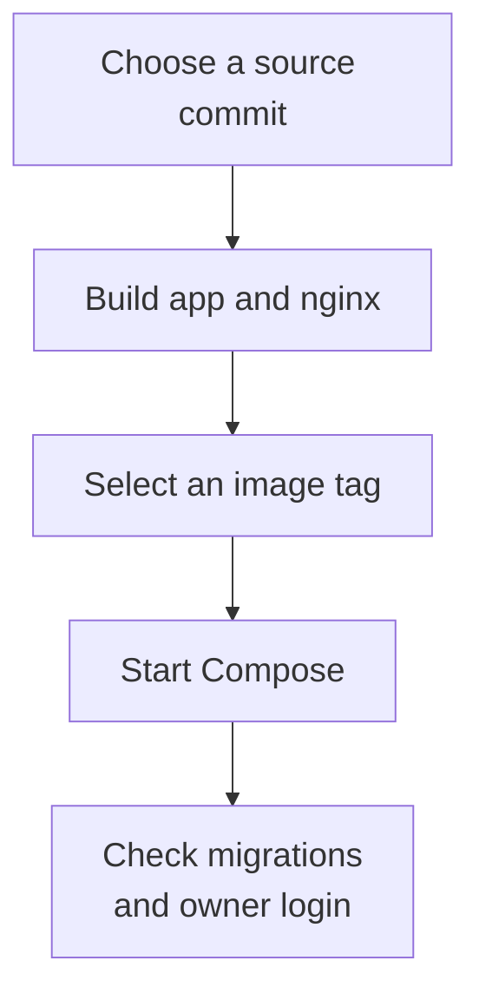
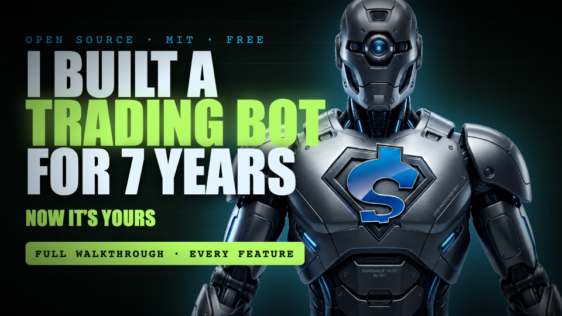

# shoemoneyx

An open-source crypto paper-trading desk with a backtest farm, walk-forward
optimization, a strategy builder, and sub-minute candles built from trade data.
Bring your own strategy and exchange.

Laravel 13 · Vue 3 · Redis · MySQL/MariaDB · TradingView lightweight-charts.

> **Source and release status — October 24, 2026:** `main` contains the pending
> 0.3.0 password, agent-runtime, execution and infrastructure fixes. The latest
> published GitHub release is [v0.2.4](https://github.com/shoemoney/shoemoneyx/releases/tag/v0.2.4).
> Pulling a published image does not deploy the current checkout. Use the source
> build below to run the changes in `main`; a new container/AMI release and live
> certificate acceptance are separate work.

| Start here | Guide |
|---|---|
| See the detailed changes and historical releases | [Changelog](CHANGELOG.md) |
| Upgrade an existing installation | [Upgrade guide](docs/UPGRADING.md) |
| Find a task, architecture reference or operational guide | [Documentation index](docs/README.md) |
| Understand what has actually been validated | [Dated validation snapshot](CHANGELOG.md#validation-snapshot) |
| Report a security issue or contribute | [Security](SECURITY.md) · [Contributing](CONTRIBUTING.md) |

## What it does

| Area | Behavior |
|---|---|
| Paper trading | Simulates market orders against market prices with configurable fees and slippage. |
| Exchange adapters | Native Coinbase spot/perpetual support plus generic CCXT spot adapters behind common contracts. Consult the [exchange directory](docs/EXCHANGES.md) for capabilities and conformance evidence. |
| Market data | Builds short candles from raw trades and resamples larger intervals. The configured exchange determines available feeds. |
| Backtesting | Replays a strategy over stored market data; the farm distributes parameter work to additional workers. |
| Optimization | Runs random or hill-climb candidates and walk-forward train/test windows. |
| Strategy building | Saves versioned strategy definitions, offers backtests and runs the guided agent through the pinned PHP LangChain/LangGraph SDK. |
| Dashboard | Shows positions, runs, market charts, backtests, configuration and account-scoped arena activity. |
| Execution controls | Keeps risk checks separate from entry scanning, requires explicit live-mode confirmation, and reconciles order intents before booking repeats. |

This repository ships examples and paper-trading tools. A successful backtest or
fixture test does not establish a profitable live strategy.

## Choose an installation path

| Path | What runs | Use it when |
|---|---|---|
| [Build the current source](#build-the-current-source-with-docker) | Both application and nginx images built from your checkout | You need the pending 0.3.0 fixes already merged into `main`. |
| [Use a published image](#use-a-published-image) | The selected registry tag | You deliberately want a published release and have checked which fixes it contains. |
| [Run without Docker](#fresh-development-install-without-docker) | PHP and Node processes on your machine | You are developing the application or managing its dependencies yourself. |



### Build the current source with Docker

Docker supplies PHP, Node, the web server, database, Redis, queue, scheduler,
desk loop and feeder. You need Docker Engine/Desktop with Compose, Git, OpenSSL
and Bash 4 or later for `docker/up.sh` (it uses associative arrays). On macOS,
invoke that helper with an installed modern Bash rather than the system Bash 3.2.

For a **new checkout and new installation**:

```bash
git clone https://github.com/shoemoney/shoemoneyx.git
cd shoemoneyx

docker build --target app -t ghcr.io/shoemoney/shoemoneyx:local-source .
docker build --target nginx -t ghcr.io/shoemoney/shoemoneyx-nginx:local-source .
SHOEMONEYX_VERSION=local-source bash docker/up.sh
```

The two tags must match. The nginx target contains the built frontend copied from
the application stage; using an older nginx image with a newer app can serve an
older interface.

The helper creates `.env` only if it does not exist. It generates the installation
key, database password and one-time login key, starts Compose, and waits for the
local endpoint to answer. Open `https://localhost`; the local self-signed
certificate is distinct from the AMI's public-CA acceptance path.

**Persist your image selection:** after the helper creates `.env`, add or replace
this entry in that file:

```dotenv
SHOEMONEYX_VERSION=local-source
```

The environment prefix in the command selects the images for that invocation;
`docker/up.sh` does **not** save `SHOEMONEYX_VERSION` for later commands. Confirm
the selected image references without printing the rest of the configuration:

```bash
docker compose config --images
docker compose ps -a
docker compose logs --tail=100 migrate web nginx
```

For an existing database, use [the upgrade procedure](docs/UPGRADING.md) before
starting a newly built stack. It includes backing-service version checks and the
steps for retaining credentials, keys and volumes.

### Use a published image

The Compose services select
`ghcr.io/shoemoney/shoemoneyx:${SHOEMONEYX_VERSION:-latest}` and the matching
`shoemoneyx-nginx` tag. `docker compose pull` downloads those published image
references; it does not build the checked-out source.

Choose a release from the [release history](https://github.com/shoemoney/shoemoneyx/releases),
use its matching source/Compose configuration, and persist the chosen image version
in `.env`. At the status date above, v0.2.4 is the latest published GitHub release;
its release notes do not include the pending 0.3.0 Settings password form or newer
runtime fixes. Do not assume a tag named `latest` identifies the source commit
you just cloned.

An existing image installation should follow [Upgrading](docs/UPGRADING.md), not
repeat the fresh-install setup.

### Fresh development install without Docker

The current Docker and CI baseline uses PHP 8.5 and Node 24. A manual development
installation also needs Composer 2, npm, Redis, a configured MySQL/MariaDB database
and the PHP extensions required by the lockfile. `bin/desk` is a zsh helper.

In a fresh checkout, configure a dedicated database and Redis instance in `.env`
before starting:

```bash
cp .env.example .env
# Edit DB_* and Redis settings; leave DESK_MODE=paper.
bin/desk setup
bin/desk dev
```

`setup` installs dependencies, builds assets, generates a missing application key,
runs migrations, syncs products/candles and backfills market data. It is a
first-install convenience, not the existing-install upgrade recipe. `dev` starts
the frontend, local web server, queue worker, feeder and desk process; open
`http://localhost:8000`.

The first-run wizard establishes the owner password, connects the provider account,
selects an exchange, optionally imports a strategy, and starts in paper mode.
Market-data and provider steps use the services you configure. See
[E2E journeys](docs/E2E.md) for isolated test setup rather than pointing tests at
your working database.

## Passwords and first login

| Situation | Expected behavior in the pending 0.3.0 source |
|---|---|
| Docker first run | Use the helper's one-time `MASTER_PASSWORD`, then choose and confirm your owner password. |
| AMI first run | The instance ID is a bootstrap key only after the requested host has a matching trusted TLS activation marker. It does not bypass the first-owner password step. |
| Keyless manual install | Initial owner setup is restricted to local/private-network access; establish the password before exposing the service. |
| Password change after onboarding | Open **Settings**, then **Master password**. Enter the current password, new password and matching confirmation. |
| Password length | At least 12 Unicode characters, with a maximum of 72 UTF-8 bytes. |
| Successful rotation | This browser receives a regenerated session/CSRF token; other sessions and the old header credential stop authenticating. |
| Script access | Send the owner password in `X-Desk-Token`; do not put it in a URL or browser storage. |

The original bootstrap value may remain in an installation's private environment
file, but it stops authenticating once an owner password is set. Re-running the
helper does not reset an established owner password.

## Commands

Commands act on the configured desk, database, account and mode. Start with paper
mode; entry/risk commands can place orders when live execution is enabled.

| Command | Purpose |
|---|---|
| `php artisan desk:run` | Long-running loop with risk and scan intervals from settings. |
| `php artisan desk:cycle` | One entry pipeline pass. |
| `php artisan desk:risk` | One risk sweep. |
| `php artisan desk:ctl status` | Health, readiness, heartbeats and positions. |
| `php artisan desk:ctl halt --reason=maintenance` | Halt new entries while the running loop can continue risk management. |
| `php artisan desk:ctl resume` / `php artisan desk:ctl stop` | Clear the halt / set the running flag false. These are not liquidation commands. |
| `php artisan desk:backtest --products=BTC-USD,SOL-USD --days=30 --cash=1000` | Replay a strategy over stored data. |
| `php artisan desk:sweep --queue` | Queue a parameter sweep for farm workers. |
| `php artisan desk:optimize --space=mr --mutate=20` | Run optimizer mutations using a configured space. |
| `php artisan desk:coin show` | Inspect per-product overrides. |
| `php artisan market:sync-products` / `php artisan market:backfill --days=30` | Sync products / backfill market candles. |
| `php artisan market:backfill-trades --timeframes=33s,41s` | Build selected short-interval candles from trades. |

`bin/desk` wraps common commands. Keep exactly one intended desk-loop owner;
`DESK_USE_SCHEDULER` chooses scheduler-driven work instead of also running a
duplicate loop. [Risk](docs/RISK.md) documents terminal-position recovery and
[Farm](docs/FARM.md) documents queue workers.

## Writing a strategy

The PHP contract is [`app/Desk/Contracts/Strategy.php`](app/Desk/Contracts/Strategy.php).
Strategies receive product statistics, return scan/vet/size/risk decisions and
declare their default settings. `MeanReversionStrategy` is the built-in example;
`CustomStrategy` is the PHP template.

| Route | Reference |
|---|---|
| Choose a generic teaching template | [Starter templates](docs/STARTER_TEMPLATES.md) |
| Author a versioned JSON plugin | [Strategy plugin guide](docs/STRATEGY_PLUGIN.md) · [Schema v2](docs/STRATEGY_SCHEMA_V2.md) |
| Use the guided, tool-calling builder | [Strategy agent](docs/AGENT.md) |
| Import or share community definitions | [Strategy sync](docs/STRATEGY_SYNC.md) · [Hub API](docs/HUB_API.md) |
| Understand main-desk versus arena ownership | [Arena account history](docs/ARENA_ACCOUNTS.md) |

Settings combine application defaults, strategy defaults, stored overrides and
per-product overrides. Existing positions retain their recorded strategy/version
for exits when it can be resolved; selecting a different entry strategy does not
silently rewrite those saved rules. See [Risk](docs/RISK.md) for the legacy fallback.

## Runtime layout

| Path | Responsibility |
|---|---|
| `app/Desk/` | Desk pipeline, risk, backtests, optimization, bank and settings. |
| `app/Desk/Strategies/` | Example PHP strategies and strategy runtime support. |
| `app/Ai/` | Strategy agent, provider transport, LangChain adapter, tools and MCP. |
| `app/Exchange/` | Venue contracts, native Coinbase and generic CCXT adapters. |
| `app/Services/Market/` | Product sync, stored candles and market-data callers. |
| `app/Http/Controllers/Api/` | Dashboard, configuration, runs, backtests and datafeed APIs. |
| `resources/js/` | Vue application and frontend modules. |
| `docker/` | Compose launch helper, role entrypoint, TLS initialization and backup loop. |
| `ops/image/` | AMI build, certificate lifecycle and candidate acceptance tooling. |
| `tests/e2e/` | Provider-backed and disposable local acceptance journeys. |

## Adding an exchange

Implement the contracts under [`app/Exchange/Contracts/`](app/Exchange/Contracts/),
reuse the existing execution interface, and register the driver in
[`config/exchanges.php`](config/exchanges.php). Capability flags determine whether
the adapter supports spot, perpetuals, market data or order execution.

A directory entry is not proof that a venue is currently working. Recorded
fixtures and the conformance suite establish the repository's contract coverage;
live account/venue acceptance is separate. Follow
[Contributing](CONTRIBUTING.md) and the [exchange guide](docs/EXCHANGES.md).

## Tests and acceptance

```bash
php artisan test
npm run test:frontend
npm run test:feeder
npm run build
```

Use isolated test databases. The complete PHP suite is exercised on both SQLite
and MariaDB in CI. Browser security, concurrent-request and synthetic application
journeys prove different paths; provider-backed scripts can make paid calls and
need their own authorized credentials. The commands above do not constitute live
AMI, certificate, exchange or provider acceptance.

See the [single dated validation snapshot](CHANGELOG.md#validation-snapshot) for
the reviewed source's retained results and [E2E](docs/E2E.md) for reproduction.

## Watch the walkthrough

The walkthrough covers installation, onboarding, charts, the desk cycle,
backtesting, optimization and the strategy builder. It was published with the
earlier release and is an orientation guide; use this README and the changelog for
the current password and runtime behavior.

[](https://www.youtube.com/watch?v=C4hcYyPkhB0)

<details>
<summary>Walkthrough chapters and offline copy</summary>

| Time | Topic |
|---|---|
| 0:13 | Project introduction and paper-first approach |
| 1:29 | Installation paths |
| 2:49 | First-run setup wizard |
| 3:16 | Exchange selection |
| 5:05 | Charts and sub-minute candles |
| 6:05 | Desk scan, vet, size and fills |
| 7:14 | Backtesting and fee effects |
| 7:52 | Optimizer and walk-forward |
| 9:21 | Strategy builder |
| 11:53 | Take profit, ladder and runner |
| 12:44 | Pi re-entry |
| 13:47 | Re-anchoring stops |
| 14:40 | Built-in assistant |

The 1080p MP4 and captions are attached to the
[v0.2.1 release](https://github.com/shoemoney/shoemoneyx/releases/tag/v0.2.1).

</details>

## Contributing and license

See [Contributing](CONTRIBUTING.md) for adapter fixtures, conformance checks and
the PR process. Report security issues using [Security](SECURITY.md).

Released under the [MIT license](LICENSE).
