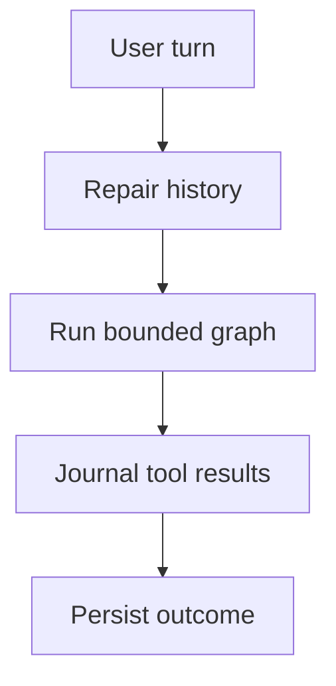

# Strategy Builder Agent

A tool-calling agent that walks a trader through building a strategy one phase at a
time, backed by `App\Ai\StrategyAgent` and the system prompt in
`App\Ai\Prompts\StrategyBuilderPrompt`. Distinct from the older SMX assist chat
(`StrategyPluginController::assist()` / `App\Desk\Assist\SmxPrompt`), which is
untouched and still the free-form chatbox in the builder UI.

The runtime described here is implemented in the pending 0.3.0 source. The dated
[validation snapshot](../CHANGELOG.md#validation-snapshot) distinguishes actual
application/SDK fixture checks from live provider and published-image acceptance.
For installation and upgrades, see [UPGRADING.md](UPGRADING.md).

## LangChain / LangGraph runtime

`StrategyAgent::turn()` invokes `LangGraph\Agents\Agent::create()` from
`shoemoney/langchain-php`, pinned to revision
`8a588b040d943fe8d7d42fef8fad05d7a0624340` in Composer. Installation uses the
public HTTPS Git repository; it does not depend on a local SDK checkout.

`App\Ai\LangChain\ChatClientModel` adapts graph messages and tool schemas to the
existing `ChatClient` contract. It never opens a provider connection itself, so
OpenRouter credential selection, authorization, usage auditing and retries remain
in the application transport. Registered application and MCP tools execute through
the graph's tool node, sequentially within each model response.

`StrategyGraph` middleware enforces the six-call budget, one retry for an empty
initial reply, complete tool-result batches, and a tools-disabled conclusion.
The conversation table remains the source of history; this integration does not
enable a second checkpoint store or change the conversation API. A per-turn journal
retains successful tool effects and their results when a later provider call fails.
Community/MCP result fencing remains in force. Obsolete `hub_register` credential
arguments are discarded before graph state, tool events and transcript persistence;
registration credentials belong in the Hub panel.



### Turn boundaries and failure recovery

| Boundary | Implemented behavior | Consequence for callers |
| --- | --- | --- |
| Tool budget | At most six application/MCP tool executions per turn, across all model rounds | A response containing more calls receives explicit skipped results for the excess; it does not gain another side-effect budget |
| Empty initial reply | One retry when no tool has executed and the reply contains neither text nor calls | An empty response does not start an unbounded retry loop |
| Tool exception | The failing tool becomes a structured error result and the remaining batch continues | Every requested call still has a matching result in the transcript |
| Conclusion | After the execution budget is exhausted, the next model request has no tools | If a provider still returns calls, they are completed as skipped results and the graph ends |
| Later provider failure | The graph retains completed effects, tool results and the underlying provider error | `StrategyAgent::turn()` saves the retained conversation before returning its error; a failed final reply is not evidence that earlier tools did nothing |
| Legacy incomplete history | Missing historical results become explicit unknown-outcome results; orphan/duplicate results are removed | Recovery does not replay an earlier tool merely because its result was not recorded |
| History size | Whole user turns are retained within a normal 40-message target | The newest complete turn may exceed the target; individual tool messages are not cut out of a batch |

The journal is the retained transcript for this invocation, not an independent
transaction manager or an exactly-once guarantee for every external MCP server.
Inspect recorded effects before retrying a user action after an error. Existing
application authorization, tool confirmation and version-pinning rules continue to
apply; installing the SDK does not grant additional trading or publication authority.

Implementation references:
[StrategyAgent](../app/Ai/StrategyAgent.php),
[StrategyGraph](../app/Ai/LangChain/StrategyGraph.php),
[ChatClientModel](../app/Ai/LangChain/ChatClientModel.php) and
[MessageCodec](../app/Ai/LangChain/MessageCodec.php).

## The seven phases

| # | Phase | Decides | Schema section |
|---|---|---|---|
| 1 | Setup | Market condition that must hold: regime, session hours, volatility | `setup.rules` |
| 2 | Trigger | The exact signal, with concrete numeric thresholds | `trigger.rules`, `trigger.max_candidates` |
| 3 | Entry | Side, confirmation checks, sizing rule | `entry.side`, `entry.confirm`, `entry.sizing` |
| 4 | Management | Adds, trailing stop, partials — or explicitly none | `management.adds`, `management.trailing`, `management.partials` |
| 5 | Exit | Stop, take profit, and time stop — all three decided | `exit.stop`, `exit.take_profit`, `exit.time_stop` |
| 6 | Risk | Max positions, daily loss cap, leverage cap | `risk.max_positions`, `risk.daily_loss_cap_pct`, `risk.leverage_cap` |
| 7 | Review | Restate the full strategy, validate, save, offer a backtest | the whole definition |

The prompt asks exactly one question per turn, refuses to advance a phase until every
field of the current phase is decided, and only ever produces the final JSON through
the `strategy_json` tool call in Phase 7 — never pasted into a chat reply.

## Tools

All tools live in `App\Ai\Tools\*`, registered via `App\Ai\Tools\ToolRegistry`.

| Tool | Purpose | Params | Example |
|---|---|---|---|
| `strategy_json` | Validate and save a strategy definition as a new plugin version | `definition` (required), `bump?`, `changelog?` | Called once in Phase 7 with the full sectioned definition |
| `run_backtest` | Run a backtest against a saved plugin, optionally pinned to a version | `plugin_id?`, `version?`, `days?`, `cash?`, `products?` | After saving, run 30 days on `BTC-USD` |
| `get_backtest` | Look up a previously run backtest by id | `id` (required) | "What were the results of run #42?" |
| `compare_versions` | Structurally diff two saved versions of a plugin | `plugin_id`, `from`, `to` (all required) | Diff `1.0.0` against `1.1.0` |
| `list_versions` | List every saved version of a plugin, newest first | `plugin_id` (required) | "What versions do I have?" |
| `suggest_share` | Surface the one-time "publish to the community archive?" UI prompt | `plugin_id?`, `version?` | Called once, right after a successful `run_backtest` |
| `set_phase` | Advance (or set) the current phase, 1-7 | `phase` (required, 1-7) | Called whenever the model moves to a new phase |
| `hub_register` | Show registration guidance; the user creates the account in the Hub connect panel. Never request credentials in chat. | None | Open the Hub connect panel to register a community account |
| `hub_status` | Check whether this desk is connected to the community hub. | (none) | Am I connected to the hub? |
| `publish_strategy` | Request publishing a saved plugin version to the community hub archive. Never publishes by itself: returns needs_confirmation and the user must confirm in the UI. The confirmed publish (App\Hub\Publisher) requires an active hub connection. | `plugin_id?`, `version?`, `changelog?` | Request to publish v1.2.0 |
| `sync_strategies` | Check the community strategies repo for new or updated strategies, read-only. Importing needs the user's confirmation in the UI. | `import?` | Check for new community strategies to import |
| `start_arena_seat` | Start a live arena seat running a saved strategy plugin version in paper, on its own account, against the current champion. | `version_id?`, `label?`, `cash?` | Start a new arena seat with my latest strategy |
| `arena_scoreboard` | Get the current live arena scoreboard: every seat's equity, PnL, drawdown, win rate, trade count and delta against the champion. | (none) | Show me the current arena scores |

Every tool's `run()` returns a JSON-serializable array; a missing plugin, backtest,
or version comes back as `{"error": "..."}`. Unexpected tool exceptions are also
converted to tool error results, so the rest of the batch can continue.

## `agent_conversations` schema and routes

Table `agent_conversations` (migration
`database/migrations/2026_09_10_000004_create_agent_conversations_table.php`):

| Column | Type | Notes |
|---|---|---|
| `user_id` | nullable FK → `users`, null on delete | |
| `plugin_id` | nullable FK → `strategy_plugins`, null on delete | the plugin this conversation is building/editing |
| `messages` | json | OpenAI-shape message list; newest complete turns within a 40-message target |
| `phase` | tinyint, default 1 | current phase, 1-7 |

Routes (`routes/api.php`, inside the existing `DeskToken` group):

```
POST /api/agent/conversations                        # create a conversation, optional plugin_id
POST /api/agent/conversations/{conversation}/turn     # send a user message; content, tool_events, phase and error describe the turn
GET  /api/agent/conversations/{conversation}          # read the conversation row
```

The turn endpoint returns HTTP 200 for completed, capped and tool-error turns. A
provider/model failure returns HTTP 502 with the retained partial result, including
any `tool_events` that already ran. Read that body and the saved conversation before
retrying; a non-2xx response does not roll back successful earlier tools.

`StrategyAgent::turn()` caps tool execution at 6 per turn (not 6 rounds — 6 total tool
*calls* across however many rounds it takes). Excess calls in a batch receive skipped
results, and the concluding model request has no tools. Every assistant tool call
receives a result, including failed calls. History retains whole user turns within
a 40-message target; the newest turn is always kept intact even if one unusually
large tool batch exceeds that target.

## MCP client support

`App\Ai\Mcp\McpClient` is a minimal synchronous JSON-RPC-over-stdio client for a
long-lived MCP server child process. `App\Ai\Mcp\McpToolLoader::extend()` reads
`config('mcp.servers')`, spawns each enabled server, and registers every tool it
reports as a native `App\Ai\Tools\Tool` (named `mcp.{server}.{tool}`) — wired into
`ToolRegistry::withDefaults()`, so every MCP tool a configured server exposes shows up
alongside the built-in tools automatically.

Configure servers via the `MCP_SERVERS` env var — a JSON object, decoded into
`config/mcp.php`'s `servers` key:

```json
{
  "example": {
    "command": "/path/to/reviewed-mcp-server",
    "args": [],
    "env": {},
    "inherit_env": [],
    "enabled": false
  }
}
```

Each entry: `command` (required), `args` (list, optional), `env` (map, optional),
`inherit_env` (list of additional parent environment variable names, optional), and
`enabled` (bool, default `true` — set `false` to keep an entry around but skip it). A
server that fails to spawn or answer `initialize`/`tools/list` is reported and skipped
— one bad MCP server never breaks the rest of the agent's tools.

The example is intentionally disabled and its executable is a placeholder. No MCP
server is active by default. Review the chosen server's installation and runtime
requirements before enabling it; pin downloaded executables/packages to a reviewed
version. The illustrative TradingView entry in `config/mcp.php` is a comment, not an
enabled hosted data service.

Initialization sends `initialize`, waits for its response, then sends the
`notifications/initialized` notification before listing tools. The child inherits
only `PATH`, `HOME`, `LANG`, `LC_ALL` and `TMPDIR`, plus explicitly configured
`env` values and `inherit_env` names. Other parent variables, including application,
database and provider credentials, are withheld by default. Adding a name to
`inherit_env` deliberately expands this boundary.

This environment filtering is not a filesystem, network or process sandbox. An
enabled server runs as a local child process and exposes tools to the agent. Treat
the executable, its arguments and any explicit credentials as operator-controlled
configuration. MCP output is fenced as untrusted data; it is not promoted to system
instructions. See [McpClient](../app/Ai/Mcp/McpClient.php),
[McpToolLoader](../app/Ai/Mcp/McpToolLoader.php) and
[config/mcp.php](../config/mcp.php).

## ChatClient contract and OpenRouter implementation

The agent codes against `App\Ai\Contracts\ChatClient` / `App\Ai\ChatResponse` and does
not assume anything beyond that interface:

```php
interface ChatClient
{
    public function chat(array $messages, array $tools = [], ?string $model = null, array $options = []): ChatResponse;
    public function defaultModel(): string;
}
```

`$messages` and `$tools` follow the OpenAI chat-completions shape. `ChatResponse`
carries `content`, `toolCalls` (`list<array{id, name, arguments}>`), `model`, `usage`,
and `finishReason`.

### OpenRouterChatClient

`App\Ai\OpenRouterChatClient` implements this interface.
It's bound via `App\Providers\AiServiceProvider::register()`:

```php
$this->app->bind(ChatClient::class, OpenRouterChatClient::class);
```

The implementation:
- Routes all chat completions through the operator's connected OpenRouter account.
- Resolves API keys from user `AiConnection` rows (with audit trail) or from
  `services.openrouter.key` in config/services.php for self-hosted setups.
- Every request is gated and audited by [Gate](../app/Ai/Gate.php):
  `ensureAllowed()` runs before the HTTP call. Successful calls record model,
  status, duration and token/cost metadata in `ai_calls`, without storing the
  prompt, completion or tool arguments as audit payloads.
- Error auditing retains text: [OpenRouterChatClient](../app/Ai/OpenRouterChatClient.php)
  passes exception messages or the HTTP status and non-success upstream response
  body to `Gate::record()`. Gate truncates the error to 2,000 characters. An upstream
  error may echo submitted material, so this path does not guarantee payload
  redaction.
- Handles OpenRouter 429 rate limits with a single 30-second backoff retry (looping
  against a rate limit digs deeper, so one retry maximum).
- Parses OpenRouter's response into `ChatResponse`, extracting tool calls, usage, and
  finish reason into the standard shape.
