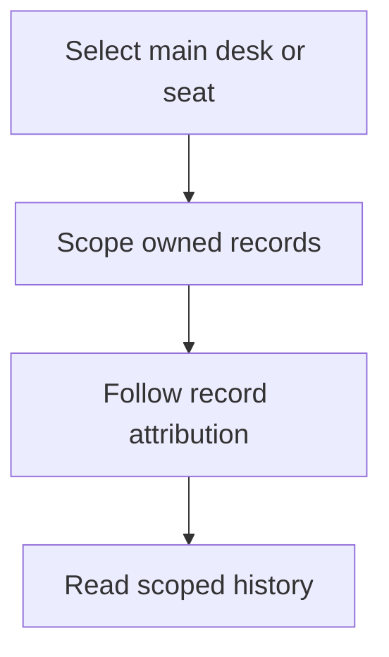

# Main desk and arena account history

The main desk and each arena seat are separate logical trading accounts. The main
desk uses rows whose `arena_seat_id` is null; a seat uses its numeric ID. An arena
seat runs in paper mode with its own positions, fills, cash and equity history.
Matching strategy names or product IDs do not transfer ownership between accounts.



`Desk::forSeat()` scopes a desk clone to one seat and applies that seat's parameter
or immutable plugin-version selection. `Desk::openPositions()` filters by both
mode and seat; paper executors book against the same seat. Direct close/trim/add
operations follow the position's own account rather than the caller's current
main-desk context. Venue and mode protections are described in [RISK.md](RISK.md).

## What the default views contain

The dashboard, landing snapshot, end-of-day report and default positions, fills,
runs, latest-run and candidates lists show the main desk. They do not aggregate
arena accounts into the main desk's bank, open-position count or trading history.
The arena scoreboard is the dedicated comparison view for seats.

| Record | Ownership field or relationship | Relevant filtering |
| --- | --- | --- |
| Position | `positions.arena_seat_id` | Account, mode and requested status |
| Fill | `fills.arena_seat_id`, plus position/run references | Account and mode |
| Desk run | `desk_runs.arena_seat_id` | Account and mode |
| Candidate | Owning `desk_run_id` | The run's account and mode |
| Bank/equity history | Seat-scoped ledger and snapshots | The account being valued |

The account selector must name an existing positive seat ID. Omitting it selects
the main desk; it is not an all-accounts wildcard. Shared desk authentication still
applies to these endpoints.

## Reading a specific seat

Supply `arena_seat_id=<seat id>` to the supported collection endpoints. The
following are request paths for an already authenticated client; `7` is an example
ID and must be replaced with an existing seat.

```text
GET /api/positions?arena_seat_id=7&mode=paper&status=all
GET /api/fills?arena_seat_id=7&mode=paper
GET /api/runs?arena_seat_id=7&mode=paper
GET /api/candidates?arena_seat_id=7&mode=paper
GET /api/runs/latest?arena_seat_id=7
```

The first four paths accept a mode selection. `GET /api/runs/latest` uses the desk's
current mode; it does not read a separate `mode` override. If the desk is in live
mode while the seat's runs are paper, use the explicit paper-mode runs collection
rather than interpreting an empty latest-run response as missing historical data.

A collection account filter does not replace record identity. Direct
`GET /api/positions/{position}` and `GET /api/runs/{run}` detail URLs address their
specific records. Inspect their returned mode, `arena_seat_id` and venue/version
fields before planning an operation. Never choose a recovery target from product
name alone.

## Retiring and deleting seats

| Operation | Current effect |
| --- | --- |
| Retire | Marks the seat `retired` and records `stopped_at`; the next arena cycle does not select it for new work, while its history and champion flag remain |
| Delete | Requires the seat to be retired first; deletes its attributed records through the schema's cascade relationships |
| Browse retired history | Continue using the retained seat ID on collection endpoints |

Deletion is not a history-preserving move to the main desk. Positions, fills,
equity records and owned desk runs are not relabeled as `arena_seat_id = null`.
Deleting attributed runs also removes their candidate history. Retiring a seat
is the appropriate history-retaining action; it is not a claim that all its
positions were liquidated at the venue.

## What the ownership migration can reconstruct

Before `2026_10_23_000001_add_arena_seat_id_to_desk_runs.php`, runs did not identify
their account. The migration examines distinct owners among each run's linked
fills:

| Historical evidence | Backfill result |
| --- | --- |
| Every linked fill belongs to one non-null seat | Attribute the run to that seat |
| No linked fills | Preserve legacy null attribution |
| Linked fills identify multiple owners, including a mixture of main and seat | Preserve legacy null attribution |
| All linked fills belong to the main desk | Keep null attribution |

The migration does not infer ownership from a strategy key, product, timestamp or
champion label. Consequently, historical main-desk reports may still include old
unattributed runs that cannot be proved to belong elsewhere. New cycles record
ownership even when they do not produce a fill.

Apply the normal migrations during upgrade and keep a database backup. The
migration is written to resume its column, foreign-key, index and backfill work if
a MariaDB deployment stops between DDL statements; that does not make a database
backup optional. See [UPGRADING.md](UPGRADING.md).

## Source and acceptance references

- [Desk account scoping](../app/Desk/Desk.php) and
  [position scopes](../app/Models/Position.php)
- [Arena runner](../app/Desk/Arena/ArenaRunner.php) and
  [seat controller](../app/Http/Controllers/Api/ArenaSeatController.php)
- [History collection routes](../app/Http/Controllers/Api/RunController.php)
- [Run-ownership migration](../database/migrations/2026_10_23_000001_add_arena_seat_id_to_desk_runs.php)
- [Account isolation tests](../tests/Feature/DeskAccountScopeTest.php),
  [paper-account tests](../tests/Feature/PaperSeatAccountingTest.php) and
  [migration tests](../tests/Feature/DeskRunSeatMigrationTest.php)
- [Dated validation snapshot](../CHANGELOG.md#validation-snapshot)
