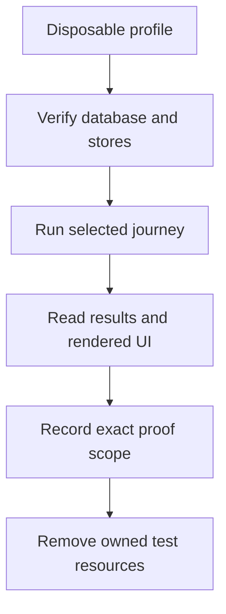

# E2E journeys and acceptance boundaries

The checked-in scripts in `tests/e2e/*.mjs` exercise a running desk through
Playwright browser pages or request contexts. They are standalone Node ESM files;
run `node tests/e2e/<name>.mjs` against the explicitly prepared disposable profile.
The sections below describe their implemented assertions and setup, not a claim
that every journey was rerun for every release.

The dated [validation snapshot](../CHANGELOG.md#validation-snapshot) records which
paths were actually checked for the pending 0.3.0 source. Its provider fixtures,
self-signed local HTTPS and fake venue results do not establish live provider,
exchange, public-CA or AMI acceptance. The older provider-backed journeys remain
available but were not the basis of that fixture-backed authentication evidence.

## Choose the right proof

| Journey family | Authentication and dependencies | What a successful run establishes | What it does not establish |
| --- | --- | --- | --- |
| Provider-backed browser journeys | Running browser/application, live OpenRouter access and market-data preparation; older API helpers can attach a default `X-Desk-Token` | The selected provider-backed feature assertions and rendered UI outcomes | Independent cookie/CSRF security coverage, a free provider call, or live order execution |
| `password-security.mjs` | Cookie-only browser requests and separately tested header clients; local/AWS-style loopback profiles, opt-in outbound HTTP fixture | First-owner setup, byte boundaries, rotation/revocation, CSRF behavior and first-login marker checks | Public CA trust or proof that an AWS instance was launched |
| `password-concurrency.mjs` | Independent header-authenticated request contexts, a fresh database and concurrent PHP workers | Exactly one claim/rotation winner and rejection of displaced credentials | A real overlap if the server serializes requests, or all database engines from one run |
| `application-smoke.mjs` | Actual browser cookie/CSRF requests, actual SDK, server-side HTTP fixtures and synthetic candles | Onboarding, saved immutable versions, backtest execution and persisted SDK tool results | Trading performance, a live market feed or a paid provider round trip |

**Database isolation is a setup requirement, not a universal script guarantee.**
For concurrent journeys, isolate the complete runtime: separate checkouts/profiles,
ports, databases, session stores, cache namespaces, queues/workers, browser state and
output folders. Different ports or `E2E_BASE` values alone do not isolate state.
Sequential reuse requires stopping the server and all writers, then fully resetting
the owned fixture state and stores as described below. The newer security/concurrency/
application scripts reject non-loopback hosts; that host check cannot determine whether the server points at
a shared database. Never aim any journey or reset command at a shared development
or production database.



## Five provider-backed journeys

### 1. `login-and-ai.mjs` — onboarding, login gate, internal AI, chart auth

Proves a fresh desk's first-run path actually works end to end: the onboarding wizard (new
password plus confirmation, then OpenRouter key, server-validated, then exchange pick and
launch), that a second, fresh
browser session is correctly gated to `/login` once a master password exists (and that a wrong
password is rejected while the right one gets through), that the Strategy Builder's two separate
chats — the stateless SMX assist chat and the tool-calling agent chat — both produce real
model-written replies and the agent conversation persists server-side, and that the chart page's
`/api/udf/*` fetches carry the desk token (no 401s) and the lightweight-charts canvas actually
renders at a real height. Also exercises the marketplace-AMI path (login-before-wizard) when
`E2E_BOOTSTRAP_PASSWORD` is set.

Checks: `AMI desk gates on /login before the wizard` · `login page shows the instance-ID guide` ·
`root redirects to onboarding on a fresh desk` · `master-password step advanced to openrouter
step` · `openrouter step accepted the key (server validated it against OpenRouter)` · `wizard
reports completed=true via /api/onboarding` · `master_password step recorded as done` · `fresh
session is sent to /login once a master password exists` · `wrong password stays on /login with
"Wrong password."` · `correct password leaves /login` · `/api/ai/status is 200 and connected` ·
`builder shows the Connected chip` · `/api/ai/models returns a non-empty free-model list` ·
`assist chat produced a model-written assistant reply` · `agent turn produced a model-written
assistant reply` · `agent conversation persisted (GET by the id the page created is 200)` ·
`chart fetched /api/udf/history with 200` · `no /api/udf request was rejected with 401` · `chart
canvas has real height, not a collapsed 0px container` · `run completed without an unexpected
error`.

### 2. `strategy-v2-lifecycle.mjs` — schema-v2 strategy lifecycle

Proves the whole schema-v2 plugin lifecycle through the Strategy Builder UI: paste
`resources/strategies/examples/smx-pi-take-profit-v2.json` into the JSON editor, Validate it
(asserting the actual API response, not just the badge), Save it (a real `strategy_plugins` +
version row, read back via the API), then trigger a backtest from the page and poll it to a
terminal status. Because the strict momentum gate may legitimately never fire against a short
seeded tape, a 0-trade original run falls back to a relaxed copy of the same strategy to prove
the pipeline can produce trades — either way, the surviving run is asserted to have a trade whose
`rule` starts with `take_profit.` or `stop.` with sane, non-placeholder numeric literals. The
journey also PUTs `perps.whole_contracts=false` through `/api/settings` right after login, as
part of its own contract (a $1,000 backtest can't clear the whole-contract floor otherwise,
regardless of what the desk booted with) — no `.env` overrides required.

Checks: `root redirects to onboarding on a fresh desk` · `master-password step advanced to
openrouter step` · `openrouter step accepted the key (server validated it against OpenRouter)` ·
`wizard reports completed=true via /api/onboarding` · `fresh session is sent to /login once a
master password exists` · `correct password leaves /login` · `desk settings:
perps.whole_contracts forced to false for this backtest` · per fixture (`original`, and
`relaxed` when the strict one produces zero trades): `[label] Validate reports valid:true with
zero errors` · `[label] UI shows the "Valid" badge` · `[label] Save returned a plugin id` ·
`[label] GET plugin: key === '<key>'` · `[label] GET plugin: current_version is a semver string`
· `[label] a plugin version row exists for current_version` · `[label] backtest queued with an
id` · `[label] backtest reached a terminal status` · `[label] backtest produced trades (trades >
0)` · `[label] a trade's rule starts with 'take_profit.' or 'stop.'` · `[label] a trade has sane
numeric literals (entry > 0, exit > 0, finite pnl_pct)`; plus, only on the 0-trade original path,
`original strategy: 0 trades, but backtest completed with status=done and a non-null
ending_equity` · `run completed without an unexpected error`.

### 3. `agent-apply-and-backtest.mjs` — agent applies a pasted strategy and backtests it

Proves the tool-calling Strategy Agent (not the stateless assist chat) can take a pasted π v2
strategy plus a plain-English instruction and actually execute it: it pastes
`smx-pi-take-profit-v2.json` into the agent chat with "apply this strategy, then backtest
BTC-USD for 30 days with starting cash 25000", then verifies — all read back through the API,
never just "the page didn't 500" — that the turn called `strategy_json` (saving a real plugin
version with a non-empty changelog) and `run_backtest`, that the backtest finished on BTC-USD
over a ~30-day window having actually consumed candle data, opened real positions and closed real
trades, with at least one trade exiting through the plugin's own `take_profit.`/`stop.` rule
machinery, and that the assistant's reply — both the API body and the rendered DOM, scoped to the
agent chat via its `data-testid="agent-chat"` wrapper — names the real backtest id. A self-check
block runs before the browser even launches, proving the backtest-id text matcher isolates its
two layers (the "backtest #<n>" pattern, and the thousands/decimal noise-stripper) so a false
match inside "$1,000" or "1.0.0" can't slip through unnoticed. $25,000 starting cash (not the
tool's own $1,000 default) is what clears this plugin's whole-contract floor so the engine
actually opens a position — see the file's own header comment for the exact math. This journey
requires an operator-selected exact `OPENROUTER_MODEL` set server-side (see the recipe
below), capable of calling both `strategy_json` and `run_backtest` in one turn. No
particular model's current availability or reliability is established here. Record
the exact model and outcome of an authorized provider run; fixture-backed evidence
does not establish that provider/model capability.

Checks: `root redirects to onboarding on a fresh desk` · `master-password step advanced to
openrouter step` · `openrouter step accepted the key (server validated it against OpenRouter)` ·
`wizard reports completed=true via /api/onboarding` · `fresh session is sent to /login once a
master password exists` · `correct password leaves /login` · `/api/ai/status is 200 and
connected` · `agent turn completed without an upstream/tool error` · `agent turn called the
strategy_json tool to save the plugin` · `strategy_json tool call actually validated and saved
the intended plugin` · `agent turn called the run_backtest tool` · `agent turn produced a
model-written assistant reply` · `chat transcript (API body) mentions the backtest id from the
tool result` · `chat transcript (rendered DOM) mentions the same backtest id` · `a plugin with
key '<key>' exists` · `GET plugin: current_version is a semver string` · `a version row exists
for current_version, created by the agent this turn` · `version row carries a non-empty
changelog from the agent` · `run_backtest tool result carried a backtest id` · `backtest for the
applied plugin finished without error` · `backtest actually ran on BTC-USD, the product the
instruction named` · `backtest window is ~30 days, the window the instruction named` · `backtest
engine actually consumed candle data` · `backtest is pinned to a version of the applied plugin` ·
`backtest actually opened positions (entry_count > 0)` · `backtest actually closed trades (trades
> 0)` · `at least one trade closed via the plugin's own take_profit./stop. rule` · `run completed
without an unexpected error`.

### 4. `chart-and-positions.mjs` — chart canvas, a real fill marker, backward pagination

Proves the chart page actually renders a real trading history, not a placeholder. It seeds one
known paper BTC-USD position and its opening fill directly through the `Position`/`Fill` models
via `php artisan tinker` (there is no manual-order API route to drive this through the browser),
entry price and time read off the last seeded 1m candle so the fixture always lands inside
whatever window the desk backfilled. It then opens `/chart/BTC-USD` and asserts the
lightweight-charts canvas renders at a real height, the page's own `/api/udf/marks` fetch (not a
stub — the literal payload `markers.setMarkers()` consumes) carries the fixture fill as a 'B'
mark at the exact time, and the position panel shows the exact formatted entry price. It finishes
by drag-panning the chart past its loaded left edge and asserting a second, older
`/api/udf/history` request actually lands (earlier `to`, non-zero bar count) — proving backward
pagination, not just a polling refresh of the right edge.

Checks: `root redirects to onboarding on a fresh desk` · `master-password step advanced to
openrouter step` · `openrouter step accepted the key (server validated it against OpenRouter)` ·
`wizard reports completed=true via /api/onboarding` · `fresh session is sent to /login once a
master password exists` · `correct password leaves /login` · `fixture: a paper BTC-USD position +
fill were seeded via the models` · `chart canvas (.cl-chart-viewport canvas) has real height >
200px` · `the first /api/udf/history request for BTC-USD succeeded with real bars` · `chart's own
/api/udf/marks fetch carries fixture fill #<id> as label 'B' at t=<epoch>` · `position panel shows
status "open"` · `position panel shows the exact entry price "<price>"` · `panning past the left
edge triggered a second /api/udf/history request with an earlier "to" than the first` · `the
older-window request came back with real bars (candle count grew)` · `run completed without an
unexpected error`.

### 5. `support-chat-deepseek.mjs` — assist chat with deepseek model selection

Proves the SMX "AI assist" support chat (`/api/strategy-assist`) correctly routes requests to
`deepseek/deepseek-v4-flash` — a model config/ai.php lists under `recommended` — and that the
model picker persists across sessions. The journey validates that deepseek-v4-flash appears in
the builder's live Recommended model list, that selecting it via the assist chat's model
dropdown and persisting to localStorage actually routes the next call there (verified both by
request body and by the response's own `model` field echoed from the real OpenRouter reply,
proving the call was actually served by that model and not silently routed elsewhere), that the
reply is real model output containing a JSON code block for strategy drafting, and that the
free-model nudge banner appears when on a free model and clicking it switches the picker and
persists to localStorage. The nudge banner names the nudge model from config/ai.php (the
vision-exp sibling, offered for backtest review, not flash itself). No backtest or
marketplace-AMI path — just the bare assist chat against a fresh desk's onboarding and Settings
state.

Checks: `root redirects to onboarding on a fresh desk` · `master-password step advanced to
openrouter step` · `openrouter step accepted the key (server validated it against OpenRouter)` ·
`login left /login` · `deepseek/deepseek-v4-flash is in the live /api/ai/models recommended
list` · `the assist chat model dropdown offers deepseek/deepseek-v4-flash as an option` ·
`selecting the model persists it to localStorage (savePrefs)` · `assist chat produced a real,
non-canned reply` · `the reply drafts an actual strategy (contains a JSON code block)` · `a
/api/strategy-assist call was captured` · `the request body asked for deepseek/deepseek-v4-flash`
· `the server's response echoes deepseek/deepseek-v4-flash as the model that actually replied` ·
`the free-model nudge banner appears when pinned to a free model` · `the nudge names a concrete
switch-to model` · `clicking the nudge persists its model to localStorage`.

## Disposable authentication and application journeys

The other three scripts use disposable loopback profiles. The two browser scripts use an
explicitly enabled outbound HTTP fixture; the concurrency request script does not need it. See
[password-security.md](../tests/e2e/password-security.md) for the full setup,
including separate databases, sessions, caches, nginx/PHP-FPM configuration, and fixture opt-in.
They exercise real application routes, browser behavior, and request races without paid model calls or a live
market feed when the documented server-side fixture is enabled for the browser profiles. The local TLS certificate is accepted by the test browser, so these runs do not
prove public certificate trust or an AMI launch.

| Script | Profile and check | Invocation after profile setup |
| --- | --- | --- |
| `password-security.mjs` | Fresh `local` and `aws` profiles; first-owner claim, password confirmation and rotation, cookie and token authentication, first-login trust gate, and rendered readability | `E2E_PROFILE=local E2E_BASE=https://127.0.0.1:18444 E2E_HTTP_BASE=http://127.0.0.1:18132 node tests/e2e/password-security.mjs`, then `E2E_PROFILE=aws E2E_BASE=https://127.0.0.1:18443 E2E_HTTP_BASE=http://127.0.0.1:18131 E2E_TLS_STATUS_PATH=/absolute/disposable/tls-status node tests/e2e/password-security.mjs` |
| `password-concurrency.mjs` | Its own fresh non-AWS bootstrap profile, at least two PHP-FPM workers; overlapping owner claims and rotations yield exactly one winner; the losing request may return 401, 409 or 422 depending on when it observes the changed credential | `E2E_BASE=https://127.0.0.1:18445 node tests/e2e/password-concurrency.mjs` |
| `application-smoke.mjs` | After the local password journey; seeded synthetic market tape, UI strategy validation, save/version and backtest | `E2E_BASE=https://127.0.0.1:18444 E2E_PASSWORD="$DISPOSABLE_OWNER_PASSWORD" node tests/e2e/application-smoke.mjs` |

Set `PLAYWRIGHT_PATH` if Playwright is installed outside this checkout. Set
`E2E_BROWSER_CHANNEL=chrome` to use installed Chrome for the browser scripts. Before
`application-smoke.mjs`, seed only its disposable SQLite file with
`E2E_FIXTURE_MODE=1 DB_CONNECTION=sqlite DB_URL= DB_DATABASE=/absolute/output/playwright/runtime/local.sqlite php tests/e2e/fixtures/seed-market.php`.
The fixture helper rejects databases outside that runtime directory. These synthetic trades
verify execution paths; they are not trading-performance evidence. Each script writes results
under `output/playwright/` by default or to `E2E_OUT`. Set `DISPOSABLE_OWNER_PASSWORD` to the
final synthetic owner password from the local password journey before running application smoke.

## Checking the Settings password form

The form is available under **Settings**, then **Master password**, after onboarding.
Use a disposable browser profile and an independent second browser session to check
it. The tracked frontend assertions live in
[settingsPassword.test.mjs](../tests/Unit/Frontend/settingsPassword.test.mjs);
[MasterPasswordTest.php](../tests/Feature/MasterPasswordTest.php) and
[PasswordSecurityTest.php](../tests/Feature/PasswordSecurityTest.php) cover the
backend boundaries. The dated changelog records the separate retained browser
acceptance for the Settings form; there is no additional checked-in Settings
browser script implied by that record.

1. Sign in to the same disposable desk in both browser sessions and finish onboarding.
2. Open the form; verify short, mismatched and over-72-byte replacements cannot submit.
3. Submit a valid replacement with a wrong current password. Verify the field error,
   unchanged owner credential and continued authentication in both sessions.
4. Submit the exact current password plus matching new password/confirmation. Verify
   success and cleared password inputs.
5. Make another Settings write from the first browser. It must work with the refreshed
   CSRF token; other Settings writes must not overlap the password change.
6. Verify the second browser and an independent old-password header client lose access,
   while a fresh browser can sign in using the new password.
7. Review the form at desktop and mobile widths, including keyboard access, validation
   messages, readable input text and wrapping.

Do not use a live trading desk or publish the passwords, cookies or request headers
collected while reproducing these checks.

## Provider-backed fresh-desk recipe

Start from a separate checkout with its own environment and no cached production
configuration. Do not copy an operator's `.env` or its application/database keys.
Install the dependencies and prepare a fresh test `APP_KEY` in that new checkout
using the [manual-install guidance](UPGRADING.md). Never regenerate an existing
operator installation's key to run a journey.

These journeys use live OpenRouter calls and may incur provider charges; run them only with
authorization for those calls. Concurrent journeys each need their own complete disposable
runtime, including a separate checkout/environment, database, session and cache stores,
queue/workers, browser state, port and output folder. Four scripts default to ports 8010–8013;
`support-chat-deepseek.mjs` also defaults to 8010, colliding with `login-and-ai.mjs`.
Set distinct `E2E_BASE` values and matching server ports **as well as** isolating those resources.
Sequential reuse is possible only while the desk is stopped/quiescent and after the complete
reset described below. Never run these journeys against a shared database.

```bash
# 1. Supply an authorized OpenRouter key to this shell without printing it.
# These journeys make live provider calls; support-chat-deepseek may incur paid charges.
# 2. Isolated SQLite desk (repeat in a separate checkout/runtime per concurrent journey)
S=$(mktemp -d "${TMPDIR:-/tmp}/shoemoneyx-e2e.XXXXXX") || exit 1
: > "$S/e2e.sqlite" || exit 1
export SMX_E2E_ROOT="$S" SMX_E2E_EXPECTED_DB="$S/e2e.sqlite"
export APP_URL=http://127.0.0.1:8010 DB_CONNECTION=sqlite DB_DATABASE="$S/e2e.sqlite" DB_URL= \
       SESSION_DRIVER=file CACHE_STORE=file QUEUE_CONNECTION=sync BROADCAST_CONNECTION=log
# Journey 3 needs an exact operator-selected model that can call strategy_json and
# run_backtest in one turn. Set its ID before starting the server; this is no model proof.
# export OPENROUTER_MODEL='<operator-selected exact model ID>'

# 3. Assert the resolved connection and real file ownership, then migrate in the SAME
# bootstrapped Laravel process. Paths enter through dedicated environment variables;
# the quoted heredoc prevents shell interpolation into PHP code.
# Abort on cached/wrong connections, SQLite URIs, :memory: or any other file.
php <<'PHP' || exit 1
<?php
try {
  require getcwd() . "/vendor/autoload.php";
  $app = require getcwd() . "/bootstrap/app.php";
  $app->make(\Illuminate\Contracts\Console\Kernel::class)->bootstrap();
  if (config("database.default") !== "sqlite") {
    throw new \RuntimeException("Expected the disposable SQLite connection");
  }
  $db = \Illuminate\Support\Facades\DB::connection();
  $rootPath = getenv("SMX_E2E_ROOT");
  $expectedPath = getenv("SMX_E2E_EXPECTED_DB");
  $actualPath = $db->getDatabaseName();
  $root = is_string($rootPath) && $rootPath !== "" ? realpath($rootPath) : false;
  $expected = is_string($expectedPath) && $expectedPath !== "" ? realpath($expectedPath) : false;
  $actual = is_string($actualPath) && str_starts_with($actualPath, "/") ? realpath($actualPath) : false;
  if ($db->getDriverName() !== "sqlite" || $root === false || $expected === false
      || $actual === false || $expected !== $root . "/e2e.sqlite"
      || $actual !== $expected || ! is_file($expected)) {
    throw new \RuntimeException("Refusing a database outside the owned disposable e2e.sqlite");
  }
  exit(\Illuminate\Support\Facades\Artisan::call("migrate", ["--force" => true]));
} catch (\Throwable $e) {
  fwrite(STDERR, $e->getMessage() . PHP_EOL);
  exit(1);
}
PHP

# Market preparation uses that same isolated checkout/environment; do not change its config.
php artisan market:sync-products
php artisan market:backfill BTC-USD --timeframe=1H --days=11
php artisan market:backfill BTC-USD --timeframe=1m --days=9

# 4. Frontend build + server
npm run build
php artisan serve --host=127.0.0.1 --port=8010 &

# 5. Playwright — a global install is fine, point PLAYWRIGHT_PATH at it
export PLAYWRIGHT_PATH=/path/to/node_modules/playwright
# (first time only) npm i -D playwright && npx playwright install chromium

# 6. Run a journey
E2E_BASE=http://127.0.0.1:8010 E2E_OUT="$S/out" OPENROUTER_API_KEY="$OPENROUTER_API_KEY" \
  node tests/e2e/login-and-ai.mjs
```

Repeat step 6, with a fresh runtime or complete between-journey reset, for
`strategy-v2-lifecycle.mjs`, `agent-apply-and-backtest.mjs` (needs `OPENROUTER_MODEL` set on the server as above), `chart-and-positions.mjs` (needs `php artisan`
on `$PATH` in the same shell, since it shells out to `php artisan tinker` against
`E2E_BASE`'s own repo checkout to seed its fixture), and `support-chat-deepseek.mjs` (tests the
assist chat's model picker; needs a live `OPENROUTER_API_KEY` and makes real paid calls with the
model pinned to `deepseek/deepseek-v4-flash`, overridable via `E2E_SUPPORT_MODEL`; uses a fresh
desk with no backtest or marketplace-AMI bootstrap).

### Between-journey reset

Every provider journey asserts a fresh onboarding wizard. Before sequentially reusing an
owned disposable checkout, stop its server, queue workers, scheduler, feeder and any other
writers; wait for outstanding requests/jobs to finish. Recreate the owned disposable SQLite
file, repeat the guarded migration and market preparation above, clear only that checkout's
isolated session/cache/queue stores, and use fresh browser state and an output folder for the
next run. Restart the server only after preparation completes. If any resource is shared or
its cleanup is uncertain, prepare a new isolated runtime instead. Never truncate a live file or
reuse a completed operator desk.

The following is **only a limited onboarding/auth/settings reset** for an already quiescent,
owned disposable fixture. It is not the complete reset needed before another journey: saved
strategies, backtests, positions, fills, queued work, browser state and other fixture state can
remain. The connection/file assertion runs inside the same bootstrapped Laravel process as the truncations;
a separate earlier diagnostic dump would not protect against changed or cached configuration.

```bash
php <<'PHP' || exit 1
<?php
try {
  require getcwd() . "/vendor/autoload.php";
  $app = require getcwd() . "/bootstrap/app.php";
  $app->make(\Illuminate\Contracts\Console\Kernel::class)->bootstrap();
  if (config("database.default") !== "sqlite") {
    throw new \RuntimeException("Expected the disposable SQLite connection");
  }
  $db = \Illuminate\Support\Facades\DB::connection();
  $rootPath = getenv("SMX_E2E_ROOT");
  $expectedPath = getenv("SMX_E2E_EXPECTED_DB");
  $actualPath = $db->getDatabaseName();
  $root = is_string($rootPath) && $rootPath !== "" ? realpath($rootPath) : false;
  $expected = is_string($expectedPath) && $expectedPath !== "" ? realpath($expectedPath) : false;
  $actual = is_string($actualPath) && str_starts_with($actualPath, "/") ? realpath($actualPath) : false;
  if ($db->getDriverName() !== "sqlite" || $root === false || $expected === false
      || $actual === false || $expected !== $root . "/e2e.sqlite"
      || $actual !== $expected || ! is_file($expected)) {
    throw new \RuntimeException("Refusing a database outside the owned disposable e2e.sqlite");
  }
  \App\Models\Setting::truncate();
  \App\Models\AiConnection::truncate();
  \App\Models\ExchangeCredential::truncate();
} catch (\Throwable $e) {
  fwrite(STDERR, $e->getMessage() . PHP_EOL);
  exit(1);
}
PHP
```

This limited reset retains candles and all other tables. It also does not clear sessions or
cache; those stores must be isolated and reset as appropriate for the intended fixture.

### Rule

**Require an isolated database for every E2E run.** Provider journeys use `DB_CONNECTION=sqlite`
against a throwaway file under `/tmp` (or another scratch directory). The concurrency journey
may instead use a dedicated disposable MariaDB database. Never point a journey at a shared
development or production database. Each journey's fixture data (including onboarding state
and seeded positions and fills) stays in its own disposable database.
