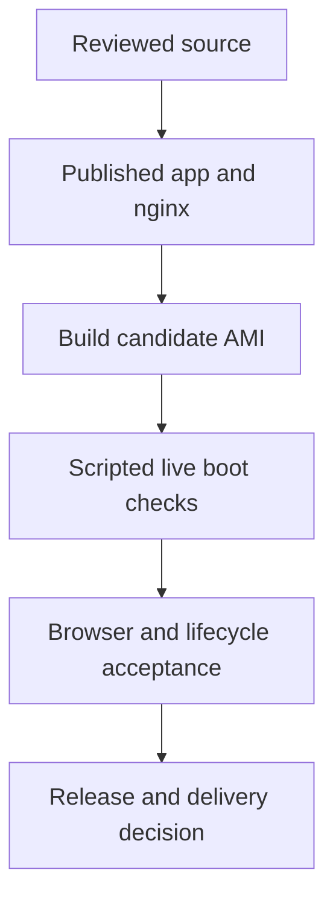

# Per-customer desk image: build, boot and acceptance

This guide describes the implemented Packer, boot, certificate and release tooling
for a per-customer paper desk. The pending 0.3.0 source contains additional fixes;
merging that source does not itself publish containers, register an AMI or establish
browser-trusted TLS on a newly built candidate.

| Artifact or evidence | Meaning |
| --- | --- |
| Source on `main` | Reviewed implementation; install from source explicitly when published images do not yet contain it |
| Public GitHub release/tag | A versioned source release; the last documented GitHub release is v0.2.4 |
| App and nginx registry tags/digests | The exact container artifacts a desk or AMI runs; both must exist for a version |
| `ops/image/releases.json` | Historical release records, not proof that a newer source commit was booted |
| Candidate AMI acceptance | Evidence for the candidate's recorded source and container digests, including live certificate and password checks |
| Marketplace delivery | A separate submission/state transition; source promotion does not complete it |

The [validation snapshot](../CHANGELOG.md#validation-snapshot) records the local and
hosted checks already performed, and their limits. For source builds or an existing
installation upgrade, start with [UPGRADING.md](UPGRADING.md).

The build uses [Packer](https://developer.hashicorp.com/packer) and
[`ops/image/desk.pkr.hcl`](../ops/image/desk.pkr.hcl). It provisions Ubuntu 24.04,
Docker and a released version of both `ghcr.io/shoemoney/shoemoneyx` and
`ghcr.io/shoemoney/shoemoneyx-nginx`. Application source is not compiled on the
customer's first boot. `docker/up.sh` generates a random `APP_KEY` and database
password there; AMI first boot supplies the EC2 instance ID as the one-time bootstrap
`MASTER_PASSWORD`.



## What's in the image

- Ubuntu 24.04 LTS, `t3.small`, Docker Engine + the compose plugin (from Docker's own apt repo)
- `/opt/shoemoneyx` cloned from `https://github.com/shoemoney/shoemoneyx` at the release tag
  `v<version>` — just the compose file, `docker/up.sh`, and `.env.example`; the app itself runs
  from the pinned `ghcr.io/shoemoney/shoemoneyx:<version>` / `shoemoneyx-nginx:<version>` images,
  pulled at build time (`docker compose pull`) so first boot needs no registry round trip
- systemd units: `shoemoneyx-first-boot` (runs once — attempts TLS activation, pins the version,
  hands off to `docker/up.sh`, writes credentials), `shoemoneyx-firewall` (runs at every boot,
  after `docker.service`), and `shoemoneyx-acme.service` + `.timer` (certificate renewal, below)
- `certbot` >= 5.4 in `/opt/certbot` (from PyPI: Ubuntu 24.04's apt package predates IP-address
  certificates), with certbot and every dependency pinned in `ops/image/files/certbot-requirements.txt`
  (bump procedure in its header). Only the program: no certificate, ACME account key or email is in the image
- `ufw` (inbound 22 + 443 only, apart from the brief port-80 challenge window below, outbound 443 + 53 only, plus UDP 123 to the Amazon Time Sync address 169.254.169.123) **and** a `DOCKER-USER` iptables policy
  that mirrors the same outbound 443/53 rule for container-originated traffic — both owned by
  `ops/image/files/firewall.sh`, applied once at the end of provisioning and reapplied on every
  boot, because Docker rewrites iptables on every `dockerd` start and none of it survives a reboot

No secrets are baked in. On first boot,
[`docker/up.sh`](../docker/up.sh) generates a random `APP_KEY` and local MariaDB
password. The AMI's
[`first-boot.sh`](../ops/image/files/first-boot.sh) reads the EC2 instance ID from
IMDS and supplies it to that helper as `MASTER_PASSWORD`, the one-time first-login
key. The helper generates a random 24-character `MASTER_PASSWORD` only when its
override is unset or empty; that fallback is not the normal AMI bootstrap key.

## Build

`ops/image/release.sh` is the one entry point a human runs to cut a desk-image release. It wraps
the packer build, the boot test, and the release bookkeeping that used to be three separate manual
steps.

Inspect the sequence without creating resources:

```bash
bash ops/image/release.sh --dry-run 0.3.0
```

`0.3.0` in this dry-run is a proposed version, not a claim that its tag or images
already exist. An actual release requires separate authorization, a real public
`v<version>` tag and both matching published container images. After verifying those
prerequisites, set `RELEASE_VERSION` to the intended published version and invoke
`bash ops/image/release.sh "$RELEASE_VERSION"` as an explicitly approved release operation.

`--dry-run` prints the planned sequence without executing it, so it works without
network access or AWS credentials. `bash ops/image/release.sh --status "$RELEASE_VERSION"`
prints that version's record from `ops/image/releases.json` and, if a Marketplace change
set has been submitted for it, the change set's current status. Set `RELEASE_NO_PUSH=1` to skip
the `git push origin main` the script runs after committing the release record.

Needs `packer` (`brew install hashicorp/tap/packer`, then `packer init ops/image/desk.pkr.hcl` once
per checkout) and an AWS identity with EC2 and AMI permissions (`aws sts get-caller-identity`
should already work), plus a default VPC in the target region (`us-east-1` unless overridden with
`-var region=...`). `version` has to match a real release: a `v<version>` git tag (for the compose
file / `up.sh` clone) and a published `<version>` tag on both ghcr.io images.

`release.sh` runs five stages in order.

1. Preflight checks everything at once and reports every failure rather than stopping at the
   first. `version` has to look like `X.Y.Z`, the `v<version>` tag has to exist on origin, the
   working tree has to be clean, and both `ghcr.io/shoemoney/shoemoneyx:<version>` and
   `ghcr.io/shoemoney/shoemoneyx-nginx:<version>` have to be pullable anonymously. That
   registry check establishes anonymous manifest availability. Separately inspect the
   intended platform manifests, digests and image-workflow result; HTTP availability
   alone does not establish a complete multi-architecture release.
2. Build runs, under the hood, the same command as before:

   ```bash
   packer build -color=false -var version="$RELEASE_VERSION" ops/image/desk.pkr.hcl
   ```

   This step is convergent. It first asks EC2 for an AMI owned by this account tagged
   `Project=shoemoneyx` and `Version=<version>` in state `available`, and adopts that instead of
   building a second one. A rerun after a crash resumes instead of rebuilding. Builds in the
   default VPC on a temporary keypair/security group that Packer manages and tears down itself, and
   takes a few minutes: OS packages, Docker Engine, cloning the release tag, pulling the two pinned
   images, then the firewall script.
3. Boot test runs `ops/image/test-boot.sh` against the new AMI. See [Boot test](#boot-test) below for what
   it checks.
4. Record upserts the release into `ops/image/releases.json`, commits it, pushes to origin unless
   `RELEASE_NO_PUSH=1` is set, and tags the AMI `BootTested=true`.
5. Marketplace is optional. If `ops/image/marketplace.env` exists (copy it from
   `ops/image/marketplace.env.example`, it's gitignored) or `MARKETPLACE_PRODUCT_ID` /
   `MARKETPLACE_ROLE_ARN` are set, this stage submits an `AddDeliveryOptions` change set for the new
   version via `aws marketplace-catalog start-change-set` and records the change set id and status.
   If it isn't configured, the script prints the seller-registration and product-creation steps and
   exits 0, with the release from stage 4 still recorded.

`ops/image/releases.json` replaces the old single-line AMI pointer file. It's a committed JSON
array with one object per released version, upserted in place as a release advances through
`built`, `tested`, `recorded` and `published`. An illustrative record shape is:

```json
{
  "version": "0.2.4",
  "commit": "<full 40-char git sha of the v0.2.4 tag's commit>",
  "ami_id": "ami-...",
  "ami_name": "shoemoneyx-desk-0.2.4-<packer-timestamp>",
  "built_at": "<ISO8601 UTC>",
  "boot_test": { "passed": true, "at": "<ISO8601 UTC>" },
  "marketplace": { "change_set_id": "...", "status": "...", "at": "<ISO8601 UTC>" }
}
```

`marketplace` is `null` until a change set has been submitted for that version.
The script's computed `published` label means a Marketplace `change_set_id` was
recorded. It does not mean AWS finished or accepted that change set. Inspect its
actual status and delivery metadata before claiming Marketplace availability.

## Boot test

`ops/image/test-boot.sh` is the source of truth for "does this image actually work." `release.sh`
runs it automatically as stage 3, and it launches a real `t3.small` from the AMI, in the default
VPC, behind a temporary security group (22 from the script's configured SSH CIDR, 443 and 80 from anywhere; 80 is only there so Let's Encrypt can reach
the HTTP-01 challenge), and asserts:

1. HTTPS answers within 10 minutes; normal TLS verification of `/login` succeeds, the issuer is
   Let's Encrypt, the IP appears in the certificate SAN, and the AWS first-login guide appears
   without the certificate warning banner
2. only after those trust checks, retrieves the disposable instance's bootstrap credential over
   SSH; the bootstrap credential cannot access `/api/status` (HTTP 403
   with `set_password_required`), but can access `/api/onboarding`
3. claims a random owner password using matching password confirmation; the owner credential
   then gets HTTP 200 from `/api/status` with `health.mode=paper`, while the consumed bootstrap
   credential gets HTTP 401 or 403 from `/api/onboarding`. Authenticated curl requests verify TLS
   and keep credentials out of command arguments and failure logs
4. `docker compose ps` shows `web` healthy and `nginx` up
5. from inside the `web` container: an outbound HTTPS call succeeds and a plain outbound HTTP call
   is blocked — proving the `DOCKER-USER` egress policy holds for container traffic, not just the
   host's own `ufw` rules
6. `nmap -p 1-1024 <ip>` shows only `22` and `443` open, `ufw` has no inbound `80` rule, and a
   plain `http://<ip>/` gets no answer — the challenge window is shut again
7. the clock is synchronized (`timedatectl` reports `NTPSynchronized=yes` and `chronyc tracking`
   names `169.254.169.123`): Coinbase JWTs expire after 120 s and ACME validation needs a sane
   clock, and the firewall only lets NTP reach Amazon Time Sync, which chrony is pointed at

Then it terminates the instance and deletes the temporary security group, success or failure.

`release.sh` skips this stage when `ops/image/releases.json` already records a passing boot test
for the exact AMI id stage 2 just built or adopted. If the test fails, `release.sh` deregisters the
AMI, deletes its snapshots, records nothing, and exits non-zero, so a half-released image never
sits around waiting to be found by an unlucky customer.

`bash ops/image/test-acme.sh` is the local, no-AWS companion: it drives `files/acme.sh` against stubbed
`ufw`/`certbot`/`docker`/IMDS and asserts port 80 is open only while certbot runs and closed after
success, failure, SIGTERM and a stale leftover rule, that the certificate is seeded into the volume,
and that the self-signed fallback comes back when needed.

To run it by hand against a specific, newly built candidate AMI:

```bash
bash ops/image/test-boot.sh ami-xxxxxxxxxxxxxxxxx
```

Requires the `smx` EC2 key pair's private half at `~/.ssh/smx.pem` (override with
`DESK_TEST_SSH_KEY` / `DESK_TEST_KEY_NAME`), and `nmap`/`jq`/`aws` on the machine running the test.

### Live candidate acceptance

Local checks are a prerequisite, not proof of public CA issuance or the published image. Confirm
the candidate AMI was built from the reviewed fixes and record its source commit and both app and
nginx container digests. Consult `ops/image/releases.json` for recorded releases; an earlier
version's boot result cannot validate later source changes. With an authorized AWS identity,
the required EC2 permissions, and a **new candidate AMI ID**, run:

```bash
bash ops/image/test-acme.sh
python3 -B ops/image/test-test-boot.py
aws sts get-caller-identity
bash ops/image/test-boot.sh ami-xxxxxxxxxxxxxxxxx
```

The last command creates charged AWS resources, tests the candidate, and attempts to terminate
the instance and delete its temporary security group on exit. Check those resources are gone;
cleanup is best effort if AWS rejects a request. Use the default VPC, supported subnet, key pair,
and tools described above. This test proves its scripted boot checks on that candidate. A normal
browser visit needs a **separate retained disposable instance**, because `test-boot.sh` terminates
its instance. In a browser that trusts the public CA, visit the candidate's HTTPS login page
without a certificate bypass, confirm the AWS first-login guide and no trust warning, enter the
instance ID once, set a new password with confirmation, then confirm the old bootstrap key is
denied. Inspect the owner paper status, service health, synchronized clock, firewall, and the
closed port-80 challenge window.

For renewal acceptance, observe an actual later certificate replacement: record the initial
fingerprint and expiry, let a scheduled renewal run when the installed certificate is within
the source's renewal window, and confirm fingerprint and expiry advance while browser trust
persists. A `renew` call against a certificate that is not near expiry is a no-op and proves
nothing about issuance. Also stop and start a disposable instance without an Elastic IP, verify
its changed public IP has a newly trusted SAN and that the owner's password remains valid. Clean
up the retained instance and any test resources after collecting evidence. The local fixture's
self-signed certificate and synthetic trust marker do not replace this browser check. The ACME
script has no staging-CA mode; a staging certificate would not prove normal browser trust.

These live checks remain pending until evidence is collected for the exact candidate: public CA
issuance, normal browser trust and first-owner login, actual scheduled renewal, and trusted TLS
after a public IP change. Local harness results do not establish these outcomes. A repository
code promotion does not build or publish an AMI, update the release ledger, or establish
Marketplace acceptance.

`release.sh` is a release operation: its normal path builds or adopts an AMI, boot-tests it,
records and may push the release record, and can submit a Marketplace change set. Use only
`bash ops/image/release.sh --dry-run <version>` to inspect its planned sequence during validation.
Any later image release and Marketplace submission need their own authorization and acceptance
evidence.

## Boot flow

1. cloud-init brings up the box; `docker.service` starts.
2. `shoemoneyx-first-boot.service` runs `/opt/shoemoneyx-first-boot.sh` once (`ConditionPathExists=
   !/opt/shoemoneyx/.env` skips it on every later boot):
   - reads the version baked in at build time and obtains the public IPv4 address
     (falling back to local IPv4), instance ID, region and optional `DOMAIN` tag over
     IMDS. Tag access needs `--metadata-options InstanceMetadataTags=enabled`, but
     does not need an IAM role. The credentials file's host is the domain when set,
     otherwise the address
   - attempts certificate activation **before the stack starts** (see [Trusted TLS
     certificate](#trusted-tls-certificate)): `/opt/shoemoneyx-acme.sh renew`
   - runs `docker/up.sh` with `SHOEMONEYX_VERSION` pinned and the instance ID passed
     as `MASTER_PASSWORD`, along with the AWS first-login guide, password hint and
     validated region. The helper generates `.env` with a random `APP_KEY` and
     local MariaDB password, the supplied bootstrap key, `APP_URL=https://localhost`,
     `DESK_MODE=paper`, `EXCHANGE=coinbase`, `HUB_URL=https://hub.shoemoneyx.com`,
     `QUEUE_CONNECTION=redis` and `CACHE_STORE=redis`. It brings up the Compose stack:
     `mariadb` and `redis` become healthy before `migrate`, and application services
     depend on the migration gate completing successfully. The helper then
     waits for `/api/status` to answer HTTP 200 or 401
   - persists only `SHOEMONEYX_VERSION=` in `.env` for future manual compose runs.
     `APP_URL` remains `https://localhost`. First boot deliberately does not recreate
     containers after the helper starts them: nginx resolves `web` and `reverb` at
     startup, so replacing those containers behind a running nginx can leave stale
     upstream IP addresses and produce HTTP 502
   - writes the real `https://<domain-or-address>` URL, bootstrap key and local
     MariaDB password to `/root/shoemoneyx-credentials.txt` (`0600`, root-only).
     Reporting that URL does not change `APP_URL` or restart the stack
3. `shoemoneyx-firewall.service` runs (`After=docker.service shoemoneyx-first-boot.service`),
   applying `ufw` and the `DOCKER-USER` egress policy. It also runs on every subsequent boot, since
   neither policy survives a reboot on its own.

## Trusted TLS certificate

The login page asks for the one-time bootstrap key, so the page must not make the buyer click
through a certificate warning first. The boot tooling therefore attempts to issue and activate its own certificate
from [Let's Encrypt](https://letsencrypt.org/) for the public IPv4 address or the
`DOMAIN` tag. Issuance can fail and fall back, as described below. No instance
certificate or ACME account key is baked into the AMI; those are created on the
instance. Actual CA issuance and ordinary browser trust still require candidate
acceptance evidence.

- **Requested certificate profile:** the source selects the `shortlived` profile
  for an IP target and uses Certbot's standalone HTTP-01 flow on port 80. The pinned
  Certbot environment is defined in
  [`certbot-requirements.txt`](../ops/image/files/certbot-requirements.txt). Its command
  includes `--preferred-profile shortlived --ip-address <ip>` for an IP target.
  Consult the CA's [profiles](https://letsencrypt.org/docs/profiles/) and
  [challenge documentation](https://letsencrypt.org/docs/challenge-types/) for
  external service requirements; a supported command shape is not evidence that a
  particular candidate obtained a certificate.
- **The security group must allow inbound tcp/80** from the internet (the Marketplace
  recommended group does). The instance itself keeps port 80 shut except for the seconds a
  challenge runs: `/opt/shoemoneyx-acme.sh` opens `ufw` 80, runs certbot, and closes it in an
  `EXIT` trap that also fires on SIGTERM/SIGINT; both systemd units run
  `acme.sh close-port` as `ExecStopPost=`, which runs even after a SIGKILL or timeout; certbot is
  capped at 180 s; and `shoemoneyx-firewall.service` resets `ufw` on every boot.
- **Install:** nginx still reads `selfsigned.crt`/`selfsigned.key` in the compose `tls-data`
  volume (the paths `docker/nginx-tls-init.sh` uses and leaves alone), but those are now fixed
  symlinks into `current/`, itself a symlink to a generation directory. A new cert+key pair is
  staged in a fresh generation, checked (public keys must match), and made live by swapping the one
  `current` symlink, so nginx can never see a certificate with the wrong key. Then nginx is
  reloaded; if that fails, a `pending-reload` marker makes the next run retry it and the login
  status stays `fallback` until a reload has actually succeeded. Because this runs before `docker/up.sh`, nginx's very first
  start already serves it. The original self-signed pair stays in the volume as
  `fallback-selfsigned.*`.
- **Fallback:** the self-signed pair is generated (same command as `docker/nginx-tls-init.sh`)
  before the first trusted certificate replaces it, so there is always something to go back to.
  If issuance fails (no public IP, Let's Encrypt rate limit, no outbound 443, port 80 not
  reachable) the box serves the self-signed certificate and logs why. The first-boot
  journal shows it: `journalctl -u shoemoneyx-first-boot | grep -i cert`.
- **First-login trust gate:** `acme.sh` writes `trusted` or `fallback` (plus target and time) to a
  small status file in the `tls-status` volume, mounted read-only into the `web` container
  (`desk.tls_status_path`). Until a valid `trusted` marker matches the requested IP or hostname
  and the request uses HTTPS, the first-login page in AMI mode provides recovery guidance and
  no credential form. Browser login, existing bootstrap sessions, header tokens and direct
  password setup are all refused server-side. Wait and reload, or reboot from the EC2 console;
  do not enter the instance ID through a browser certificate warning. The marker is an
  activation signal, not a substitute for the browser validating the certificate. Once the
  owner has chosen a password, this first-login marker gate no longer applies. Non-AMI local
  setup does not depend on an AMI status file.
- **Retry:** `shoemoneyx-acme.service` has `Restart=on-failure` with `RestartSec=15min` and a
  start limit of 4 per hour, so a failed issuance is retried within 15 minutes while staying
  within a bounded local retry policy. CA-side limits still apply; inspect the actual failure rather than forcing repeated requests.
- **No wasted issuances:** if a previous run got a certificate but could not install it, the next
  run installs the lineage certbot already holds (when it covers the target and is not near expiry)
  instead of asking Let's Encrypt for another.
- **Renewal:** `shoemoneyx-acme.timer` runs 10 minutes after boot and then every 12 hours (plus up
  to 30 minutes of random delay); `shoemoneyx-acme.service` also runs once on every boot. A run
  re-issues when no certificate is installed, the public IP (or `DOMAIN`) changed, the installed
  certificate does not cover it, or it has less than 3 days left (21 for a `DOMAIN` certificate);
  otherwise it does nothing. After a stop/start without an Elastic IP the new address gets a new
  certificate on that boot. Attaching an Elastic IP to a *running* instance leaves the old-IP
  certificate in place for up to about 12.5 hours (next timer run) unless you reboot the instance. If a replacement cannot be issued and the installed certificate no
  longer fits, the self-signed one is put back.

## Troubleshooting

**The browser shows a certificate warning.** Do not enter the instance ID while your browser
shows a certificate warning: the login page says so too, and this is the page the one-time key
goes into. The instance could not get its automatic certificate yet. Wait a few minutes and
reload, or **reboot the instance from the EC2 console** (no SSH needed: the boot-time run retries
immediately). A failed issuance is also retried automatically every 15 minutes. If it persists:

1. Check the instance's security group allows inbound **TCP 80 from 0.0.0.0/0**. Let's Encrypt
   validates from outside, so without it issuance can never succeed. Port 80 stays closed on the
   instance itself except during the challenge.
2. Check the instance has a **public IPv4** (a public IP is required; IPv6-only or a private
   subnet cannot be validated).
3. Read the log: `sudo journalctl -u shoemoneyx-first-boot -u shoemoneyx-acme --no-pager | tail -50`
4. Retry now: `sudo /opt/shoemoneyx-acme.sh issue` (or `renew`, which does nothing while the
   current certificate is fine). Let's Encrypt allows only a handful of certificates per
   identifier per week, so don't loop it.
5. Reaching a stuck box: `ssh ubuntu@<ip>` with the key pair chosen at launch (port 22 must be
   allowed in the security group).

**Rate limits.** Repeated launches that recycle the same public IP can hit Let's Encrypt's
per-identifier limits; the box falls back to the self-signed certificate and the timer retries.

**Port 80 should be closed.** `sudo ufw status` must show no `80/tcp` line outside a running
renewal; `sudo /opt/shoemoneyx-acme.sh close-port` removes a leftover rule.

## Getting the credentials

No SSH needed for a normal launch: the first-login key is the **EC2 instance ID**
(`i-…`, shown in the AWS console). Open `https://<ip>/`, the login page says "First login uses your
instance ID once; you'll be asked to choose your own password", paste the ID, and you land on the
set-password screen (new password plus confirmation, 12+ characters). The ID opens nothing else,
neither in the browser nor as an `X-Desk-Token`, and stops working the moment you set your password.

After onboarding, open **Settings**, then **Master password** to change it. Enter the current
password, a new password of at least 12 characters and no more than 72 UTF-8 bytes, and matching
confirmation. A successful change keeps this browser signed in and signs out other browsers.
The old password stops authenticating both browser logins and `X-Desk-Token` requests.

For scripting, `test-boot.sh` retrieves the root-only credential file over SSH after verifying
TLS and the first-login page, then keeps disposable credentials in private files. Avoid printing
that file or passing credentials in command arguments or logs. It contains the URL, one-time
`MASTER_PASSWORD`, and local MariaDB password.

## Firewall: why DOCKER-USER exists

`ufw`'s "outbound 443+53 only" is a host-level policy enforced in the `OUTPUT` chain — it only
sees traffic the host itself originates. Container traffic is *forwarded* (host → bridge or bridge
→ host), which traverses `FORWARD`, and Docker installs its own `ACCEPT` rules there before `ufw`
ever gets a say. Without a separate policy, a container can reach anything outbound the moment it
starts, regardless of what `ufw` says.

`DOCKER-USER` is the chain Docker reserves specifically for operator rules and never overwrites.
`ops/image/files/firewall.sh` flushes and rebuilds it on every boot: allow established/related,
allow each compose bridge subnet out to tcp/443, tcp+udp/53, and the IMDS address on tcp/80 (all
scoped to `-o <default interface>` so bridge-to-bridge traffic — `web` → `mariadb`, `nginx` →
`web` — is never touched), then drop anything else a bridge subnet tries to send out that same
interface. Inbound to the published `443` still works: Docker's DNAT happens before `ufw`'s
`INPUT` chain and before `DOCKER-USER` sees the packet's real destination, which is expected.

## Update procedure

### Publishing a new image release

Building a release and updating an existing installation are distinct operations.
`release.sh` can create charged EC2/AMI resources, commit and push the release
ledger, and submit a Marketplace change set when configured. Its normal execution
is not an inspection command. Use the dry-run described in [Build](#build) while
planning; perform the actual operation only for a deliberately selected released
version and a candidate with the required acceptance evidence.

The tooling can adopt an existing tagged AMI. Confirm its source provenance and
container digests rather than treating the fact that adoption succeeded as proof it
contains the newly merged fixes.

### Updating an existing instance

Follow [UPGRADING.md](UPGRADING.md) for backups, retained `APP_KEY` and volumes,
migrations, stopped writers and post-upgrade checks. On an AMI, the compose checkout
lives at `/opt/shoemoneyx` and first boot persists `SHOEMONEYX_VERSION` in `.env`.
Choose a version that has actually been published for **both** container images;
edit that setting deliberately and verify `docker compose config --images` before
pulling or restarting the stack.

`docker compose pull` retrieves the selected registry images. It does not build the
current Git checkout and cannot install an unreleased source fix by itself. For a
current-source build, use the separate app/nginx build recipe and explicit version
selection in the upgrade guide. Preserve the selected value for later commands;
`docker/up.sh` alone does not save a caller-supplied version into an existing `.env`.

Nothing in this workflow automatically upgrades existing customer instances. A new
AMI launch is a new installation with new first-boot credentials; retaining an old
instance's history and encrypted keys requires a deliberate database/configuration
migration before decommissioning it. `release.sh` does not implement an automated
blue/green customer replacement workflow.

## Memory, logs, health

- **Memory:** a 2 GB t3.small with no swap OOM-killed whichever process was largest. `provision.sh`
  now bakes a 2 GB `/swapfile` (swappiness 10), and `docker-compose.yml` gives every service a
  `mem_limit`/`memswap_limit`/`oom_score_adj` (mariadb `-900`, last to die; queue `+500`, first).
  MariaDB runs with `innodb_buffer_pool_size=160M` and `performance_schema=OFF`, php-fpm with
  `pm.max_children=4` and a 128M worker `memory_limit` (`docker/fpm-pool.conf`), the queue is one
  worker restarted past 256 MB, Redis is capped at 96 MB with `noeviction` (the cache locks `desk:cycle:*`/`desk:mutate:*` carry a TTL, so
  any evicting policy could drop one mid-order; the cache is a few small short-TTL keys and queue lists, far below the cap, and a full Redis fails writes loudly instead). Limits are `MEM_<SERVICE>` env vars in `.env` for bigger instance types.
- **Logs:** every service uses json-file with `max-size 10m` / `max-file 3`; Laravel logs to the
  `daily` channel, 7 days (`LOG_STACK=daily`, `LOG_DAILY_DAYS=7`). An instance launched from an older
  image keeps `LOG_STACK=single` in its `.env` until edited. `DeskEvent` rows are pruned after 30 days
  (`DESK_EVENT_RETENTION_DAYS`), failed jobs after 7 days, job batches after 48 h, by the scheduler.
- **Health:** `desk:run`, the scheduler and the queue worker each touch a heartbeat file under
  `storage/framework/` (the queue one via a job the scheduler dispatches every minute, so it proves
  a worker is actually pulling jobs). The compose healthchecks read those files, and the entrypoint
  watchdog (`supervise` in `docker/entrypoint.sh`) kills a wedged process so `restart: unless-stopped`
  revives it. No autoheal sidecar: it needs `/var/run/docker.sock`, which is root on the host. Queue
  staleness is 70 min because a backtest may hold the worker for its 3600 s job timeout.
  For alerting, add a CloudWatch alarm on `StatusCheckFailed` for the instance; container health is
  visible with `docker compose ps`.

## Backups and snapshots

Two layers, because they cover different failures:

1. **Nightly dump (in the stack).** The `backup` service writes
   `shoemoneyx-<UTC timestamp>.sql.gz` to the `backups` volume at 03:15 UTC (and once at start if the
   newest is over 24 h old), keeping the newest `BACKUP_KEEP` (default 7). It uses
   `--single-transaction`, so it does not lock the desk. The dump holds positions, intents and the
   encrypted exchange keys, so treat it like the DB. It guards against a bad migration or a dropped
   table; it lives on the same EBS volume, so it does **not** survive losing the volume.
   Restore (MariaDB's root password is random, so load as the app user):
   ```bash
   cd /opt/shoemoneyx && docker compose stop web desk queue schedule reverb feeder backup \
     && docker compose run --rm --no-deps -T \
       --entrypoint sh backup -c 'gzip -t /backups/shoemoneyx-XXXX.sql.gz && zcat /backups/shoemoneyx-XXXX.sql.gz | MYSQL_PWD="$DB_PASSWORD" mariadb -h mariadb -u shoemoneyx shoemoneyx' \
     && docker compose up -d \
     || echo "RESTORE FAILED: services left stopped, fix the dump or the error above, do not start the stack"
   ```
   The password never appears on a host command line: the container already has `DB_PASSWORD` from
   compose, and the dumps themselves are written `0600` (umask 077) by the unprivileged backup user.
2. **EBS snapshots (off the instance).** Tag the **instance** (the policy below targets `INSTANCE`, so
   tagging only its volumes would match nothing) and let Data Lifecycle Manager snapshot its attached
   volumes daily, keeping 7:
   ```bash
   aws ec2 create-tags --resources <instance-id> --tags Key=smx-backup,Value=daily
   aws dlm create-lifecycle-policy --description "smx daily" --state ENABLED \
     --execution-role-arn arn:aws:iam::<acct>:role/AWSDataLifecycleManagerDefaultRole \
     --policy-details '{"PolicyType":"EBS_SNAPSHOT_MANAGEMENT","ResourceTypes":["INSTANCE"],
       "TargetTags":[{"Key":"smx-backup","Value":"daily"}],
       "Schedules":[{"Name":"daily","CreateRule":{"Interval":24,"IntervalUnit":"HOURS","Times":["04:00"]},
         "RetainRule":{"Count":7},"CopyTags":true}]}'
   ```
   Restore by creating a volume from the snapshot and swapping it in, or launching an instance from a
   snapshot-derived AMI. Snapshots are crash-consistent; MariaDB recovers from its redo log on start.

## Cost planning

EC2 instances, EBS volumes/snapshots, public IPv4 addresses, traffic and retained test
resources can incur separate charges. Instance shape and storage settings in the
Packer template are implementation defaults, not a current monthly price quote.
Use the target region and your account's purchasing terms in the
[AWS pricing calculator](https://calculator.aws/) before a build or retained live
acceptance test. Verify termination and removal of temporary resources afterward.
