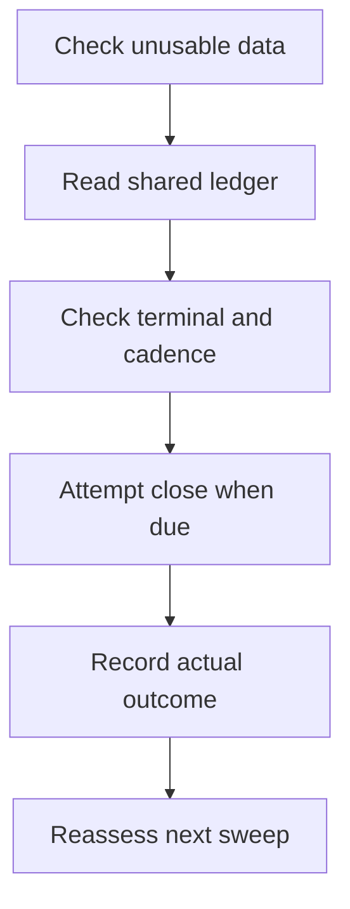

# RISK: ownership, exits and force-close escalation

RISK (`Desk::runRiskSweep()`) evaluates open positions independently of the entry
cycle. The active strategy selects new entries; an existing position carries its
own account, mode, venue and, where recorded, opening strategy/version. Those
boundaries apply before an exit, trim or add can be sent.

The pending 0.3.0 source and its dated test scope are described in the
[validation snapshot](../CHANGELOG.md#validation-snapshot). This guide describes
implementation behavior, not live-venue or strategy-performance acceptance.

## Which position can this sweep manage?

| Boundary | Current behavior | Operator implication |
| --- | --- | --- |
| Account | `openPositions()` scopes by `arena_seat_id`; null identifies the main desk, an ID identifies one arena seat | Matching product names do not make two accounts the same position |
| Mode | The sweep uses its executor's mode; close/trim route from the stored position mode | Switching the desk to live must not turn an existing paper exit into a live order |
| Venue | A non-null stored `venue` must match the executor's venue | A different configured exchange or spot/perpetual venue produces `venue_refused`; no order is sent |
| Strategy | `riskStrategyFor()` resolves the position's recorded strategy key | Changing the selected strategy does not remove an existing position's opening exit rules |
| Plugin version | A recorded `plugin_version_id` is injected into that position's risk context | Editing or promoting a plugin does not silently change the version managing that position |
| Legacy rows | Missing/unknown strategy keys fall back to the active sweep strategy; an uninferred null venue is accepted with a warning | Review legacy records explicitly; the application does not fabricate missing provenance |

A venue refusal happens before stats lookup and force-close bookkeeping. It does
not count as a failed close attempt and does not advance the terminal ladder.
Restore the matching executor configuration after checking the position's recorded
venue. Do not relabel the row merely to make a mismatched executor accept it.

A failure while evaluating one position is reported and does not prevent later
positions in the sweep from being considered. State changes use fresh position
reads under mutation locks so a sweep does not blindly overwrite metadata saved
by a concurrent close or trim.

## Unpriceable positions

There are two entry routes into the same force-close ledger, with different initial
conditions:

- **No stats:** after `risk.stale_data_retries` retries, `stats === null` enters the
  force-close decision directly. It does not wait for the zero-price threshold.
- **Non-null stats with a non-positive price:** `zero_price_sweeps` increments on
  each such sweep. Before `risk.max_zero_price_sweeps`, the position is reported as
  `stale`; at the threshold it enters the shared force-close decision.



Only cadence-eligible sweeps proceed toward a forced close. If no usable price
exists, that eligible sweep records a failed attempt without calling `close()`.
Lock timeouts and unknown order outcomes do not consume an attempt. Terminal
handling is checked before another close is attempted.

### Cadence, outcomes and recovery

| Situation | Ledger/result behavior |
| --- | --- |
| Backoff | Attempts are due when `(force_close_sweeps - 1) % force_close_backoff_sweeps == 0`; a value of one therefore attempts every sweep |
| Failed close result | A close that returns without a usable confirmed fill increments `force_close_attempts` through `recordForceCloseAttemptOutcome()` |
| Mutation lock timeout | Reported for retry on a later sweep; it does not consume a force-close attempt |
| Unknown live order outcome | Held for order reconciliation; it is not counted as a confirmed failed attempt |
| Terminal limit | RISK stops submitting force-close attempts, emits `force_close_terminal`, and repeats its warning on the configured terminal cadence |
| Terminal visibility | When a usable fallback price exists, a `RiskCheck` still records the terminal sweep rather than making the position disappear from reporting |
| No usable price anywhere | RISK tries positive stats price, positive `last_price`, then positive `entry_price`; it does not close at zero. A cadence-eligible sweep records a null failed outcome and consumes an attempt without calling `close()`. The no-price warning is limited to those eligible sweeps |
| Normal price recovery | After a positive-price risk evaluation completes, stale escalation keys are reset so a later stall starts a fresh ladder |

`zero_price_sweeps` continues to count beyond the escalation threshold, preserving
the actual stall length in reports. A terminal result means the position still
needs attention; it does not mean that the exchange position has been closed.

## Partial fills, dust and reconciliation

A close can produce a partial fill. The desk books only the quantity actually
filled, prorates the remaining basis and keeps a tradable remainder open. A pending
or unknown result is not permission to submit a second independent exit: the
order-intent record is the reconciliation path for that outcome.

A venue can also report that a remaining quantity is below its tradable minimum.
For a confirmed dust remainder, `writeOffDust()` records the remaining quantity in
`meta.dust_written_off_qty`, removes its remaining basis from the book and charges
that basis to realized PnL. This is an accounting write-off, not evidence that the
venue sold or removed the physical residual asset. Inspect the venue balance
separately when reconciling real holdings.

`OrderResult::withDust()` preserves the original result's `intentId` as well as its
fill fields and deferred ledger closure. Consequently, booking a dust-adjusted sell
can resolve its live intent in the same bookkeeping transaction. A later
reconciliation pass must not book that completed sell again.

## Config and environment

| Key | Environment variable | Default | Meaning |
| --- | --- | --- | --- |
| `risk.stale_data_retries` | No dedicated variable | `2` | Retries after the first failed stats lookup |
| `risk.max_zero_price_sweeps` | No dedicated variable | `5` | Consecutive non-positive-price sweeps before force-close escalation |
| `risk.force_close_backoff_sweeps` | `DESK_RISK_FORCE_CLOSE_BACKOFF_SWEEPS` | `5` | Attempt cadence after escalation |
| `risk.force_close_max_attempts` | `DESK_RISK_FORCE_CLOSE_MAX_ATTEMPTS` | `10` | Failed eligible force-close outcomes, including unpriceable sweeps, before terminal reporting |
| `risk.force_close_rereport_sweeps` | `DESK_RISK_FORCE_CLOSE_REREPORT_SWEEPS` | `60` | Terminal warning cadence |

These are merged strategy/desk parameters. A position's saved strategy/version and
per-product overrides can affect its effective context; inspect that context rather
than assuming a displayed global default governs every historical position.

## Manual recovery

First inspect the underlying failure: market data, venue configuration, liquidity,
exchange response or order reconciliation. A positive-price risk evaluation normally
clears the old escalation state automatically. Do not repeatedly reset terminal
metadata to force more orders while the cause remains unresolved.

If a deliberate manual reset is needed, identify the exact position and verify all
of `id`, `product_id`, `mode`, `arena_seat_id`, `venue`, `strategy` and
`plugin_version_id`. A product-only query can select another mode or an arena
account and is insufficient. Read a specific record through its detail page or
`GET /api/positions/{position}`; [account-scoped list examples](ARENA_ACCOUNTS.md)
help locate the correct ID.

Before editing, stop every process and client that can change this position,
including the desk loop, scheduler, queue/arena workers and API writers. Halting
new entries alone does not stop RISK. Preserve a database backup and inspect any
pending order intent before resuming execution.

<details>
<summary>Scoped metadata reset in an operator-controlled maintenance session</summary>

Run in `php artisan tinker` only after replacing the values with the inspected
record's identity. The zero-ID default deliberately refuses to run. Null seat means
the main desk; replace it with the verified numeric seat ID for an arena position.
The default paper values must not be reused for a live position.

```php
$positionId = 0; // Replace with the inspected position ID.
$expectedProduct = 'REPLACE_WITH_VERIFIED_PRODUCT';
$expectedMode = 'paper';
$expectedSeatId = null; // Main desk; use the verified seat ID for arena.
$expectedVenue = 'paper';

if ($positionId <= 0 || str_starts_with($expectedProduct, 'REPLACE_')) {
    throw new \RuntimeException('Inspect and specify the exact position first.');
}

\Illuminate\Support\Facades\DB::transaction(function () use (
    $positionId, $expectedProduct, $expectedMode, $expectedSeatId, $expectedVenue
) {
    $position = \App\Models\Position::query()
        ->whereKey($positionId)
        ->where('product_id', $expectedProduct)
        ->mode($expectedMode)
        ->seat($expectedSeatId)
        ->where('venue', $expectedVenue)
        ->where('status', 'open')
        ->lockForUpdate()
        ->firstOrFail();

    $position->meta = array_diff_key($position->meta ?? [], array_flip([
        'zero_price_sweeps',
        'force_close_sweeps',
        'force_close_attempts',
        'force_close_terminal_reported',
        'force_close_terminal_sweeps',
    ]));
    $position->save();
});
```

A legacy null venue needs separate investigation; this example deliberately does
not match it. The operation changes only the escalation metadata of the selected
open row. It does not close a position, resolve an intent, modify fills or repair
an exchange balance. Resume writers deliberately, inspect the next sweep and verify
that the original cause is corrected.

</details>

## Implementation and regression references

- [Desk risk, booking and reconciliation](../app/Desk/Desk.php)
- [Position scopes](../app/Models/Position.php) and
  [order-result copying](../app/Desk/Execution/OrderResult.php)
- [Per-position strategy tests](../tests/Feature/DeskRiskSweepPerPositionStrategyTest.php)
- [Venue pinning tests](../tests/Feature/DeskPositionVenuePinTest.php)
- [Zero-price escalation tests](../tests/Feature/DeskZeroPriceRiskSweepEscalationTest.php)
- [Dust close tests](../tests/Feature/DeskDustCloseTest.php) and
  [live-order idempotency tests](../tests/Feature/LiveOrderIdempotencyTest.php)
