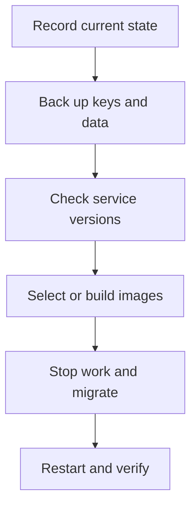

# Upgrading an existing desk

This guide separates application source, published application images and the
database/runtime services around them. Retain the existing installation's keys and
data throughout an upgrade.

> **Current status — October 24, 2026:** the public `main` branch includes the
> pending 0.3.0 fixes. The latest published GitHub release is
> [v0.2.4](https://github.com/shoemoney/shoemoneyx/releases/tag/v0.2.4). A source
> merge does not publish a new container or AMI. Build both local application
> targets if you need the current source before its separate image release.

Read the [detailed changelog](../CHANGELOG.md) and its migration inventory before
choosing a target. The [validation snapshot](../CHANGELOG.md#validation-snapshot)
states what was tested and what still needs live acceptance.

## What each operation changes

| Operation | Changes | Does not establish |
|---|---|---|
| `git pull --ff-only` | The checked-out source and tracked configuration | That running containers use this source. |
| `docker compose pull` | Local copies of selected published images | That the registry tag contains the checkout's commits. |
| Build Dockerfile `app` and `nginx` targets | Local images from the current build context | A registry release or a newly accepted AMI. |
| `docker compose up -d` | Creates/reconciles services using selected images and configuration | Healthy application state or successful owner login. |
| `migrate --force` | Applies pending database migrations | That an older application can read the resulting schema. |
| Password rotation | Replaces the owner credential and session grant | An application-key rotation or a reset of exchange credentials. |



## Before maintenance

### Record the current source and images

Run these from the installation's Compose directory:

```bash
git rev-parse HEAD
git status --short
docker compose config --images
docker compose images
docker compose ps -a
```

Record the source commit, application and nginx image IDs, selected image version,
backing-service versions and named volumes in your private maintenance record.
`config --images` shows the selected image references without dumping the full
resolved configuration and its environment values.

Do not discard local modifications to get a clean checkout. Keep installation
secrets outside source control. Existing `.env` files are ignored by Git; tracked
configuration edits still need to be reconciled deliberately before updating.

### Preserve the installation identity

| Preserve | Why |
|---|---|
| `.env`, especially `APP_KEY` | Stored encrypted credentials need the same application key after restart. |
| Database credentials | Existing database accounts and data are not recreated by changing an environment variable. |
| Owner-password state in the database | The bootstrap environment value is not a replacement for an established owner password. |
| MariaDB data volume | Holds settings, credentials, positions, fills, strategy versions, conversations and run history. |
| Redis data volume | Holds queue and runtime state; do not treat clearing it as an upgrade step. |
| TLS volumes and certificates | Preserve the installation's certificate material and activation state. |
| Backups volume and an off-host copy | A dump on the same storage is not protection against losing that storage. |

Do not regenerate `APP_KEY`, replace `.env` with the example, run `migrate:fresh`,
or remove named volumes as part of an ordinary upgrade. Those operations change or
destroy installation state rather than upgrading it.

### Check backups and backing-service versions

The Compose `backup` service writes compressed database dumps into `/backups`.
Inspect its logs and available dumps, choose a current successful backup, validate
it and keep an off-host copy together with the corresponding private `.env`.
See [Backups and snapshots](HOSTED_IMAGE.md#backups-and-snapshots) for the dump and
restore process. Prove restoration in a separate disposable database before
relying on a backup for rollback.

For example, keep local maintenance copies outside the source tree:

```bash
umask 077
UPGRADE_BACKUP_DIR="../shoemoneyx-upgrade-backup-$(date -u +%Y%m%d-%H%M%S)"
mkdir -p "$UPGRADE_BACKUP_DIR"
cp .env "$UPGRADE_BACKUP_DIR/.env"
cp docker-compose.yml "$UPGRADE_BACKUP_DIR/docker-compose.yml"
docker compose logs --tail=100 backup
docker compose exec -T backup sh -c 'ls -lt /backups'
```

Use the actual chosen dump filename when copying it out of the container; keep
that file and the environment copy private. Do not substitute an empty directory
or an unverified volume snapshot for a restore-tested backup.

**Backing-service upgrades need their own plan.** The current Compose file pins
MariaDB 13 and Redis 8. An older installation may use earlier major versions.
Check the actual running versions and the database vendor's supported transition
before reusing an existing data directory with a different major-version image.
The application's migration gate is not an engine-major upgrade procedure.

The application steps below assume your database and Redis services already have
a compatible, validated upgrade/restore path. If that has not been established,
finish that preflight before applying the new Compose configuration. Application
tests on a fresh MariaDB instance do not prove an in-place upgrade of your older
database volume.

## Select the target source and image version

### Published application images

Choose an existing published version after reading its release notes. Use the
source/Compose configuration that belongs with that version. Set or replace the
following entry in the installation's `.env` using your chosen image tag:

```dotenv
SHOEMONEYX_VERSION=<published-image-tag>
```

`<published-image-tag>` is a placeholder, not a tag to paste literally. Registry
image tags use the selected image version; a Git tag and a registry tag are
different references. Confirm that both application and nginx images exist for
the chosen version before maintenance.

Once the compatible target configuration and version selection are in place:

```bash
docker compose config --images
docker compose pull
```

Pulling images can be done before stopping application work. Check that the
resolved references are the ones you selected. If you are currently using local
source images, do not pull a registry tag over them as an application update.

### Current-source application images

In the public source checkout, review local changes first, then update to the
intended reviewed commit. A checkout that follows the public `main` branch can
use a fast-forward-only update when its history is compatible:

```bash
git status --short
git pull --ff-only
git rev-parse HEAD
```

Do not use a reset or force checkout to overwrite installation-specific work.
Record the actual commit selected for the build.

Build both targets under matching local tags:

```bash
docker build --target app -t ghcr.io/shoemoney/shoemoneyx:local-source .
docker build --target nginx -t ghcr.io/shoemoney/shoemoneyx-nginx:local-source .
```

Set or replace the following `.env` entry before restarting this existing desk:

```dotenv
SHOEMONEYX_VERSION=local-source
```

Keep the previous known-good images and record the new image IDs. Reusing the
`local-source` label makes the record important: the label alone does not identify
which commit was built. Building is local; no `--push` is part of this procedure.
The repository's `.dockerignore` defines the build context exclusions. Review
your local context instead of assuming every untracked file is excluded.

Do not mix a source-built app with a previously published nginx image. The nginx
target copies the built public assets from the app stage, so the interface must
advance with the backend.

### Image-version precedence

Compose reads `${SHOEMONEYX_VERSION:-latest}` for both application image names.
A shell environment value can override the value in `.env`. Check and resolve
any exported override, then use `docker compose config --images` before starting
services.

The prefix below affects only that helper invocation:

```bash
SHOEMONEYX_VERSION=local-source bash docker/up.sh
```

`docker/up.sh` leaves an existing `.env` alone and does not write that version
selection into a newly generated one. Persist the intended version in `.env` for
future pulls, starts and maintenance commands. AMI first-boot tooling has its own
version-pinning behavior; do not assume a plain self-hosted helper does the same.

## Apply an application upgrade

These are maintenance operations against your real installation. Check the
selected account/mode, open positions and in-flight work before changing services.

1. **Halt new entries while risk management is still running.** From the running
   stack, use the UI halt control or:

   ```bash
   docker compose exec web php artisan desk:ctl halt --reason=maintenance
   docker compose exec web php artisan desk:ctl status
   ```

   A halt is not a liquidation. Stopping the process also stops its risk sweeps;
   plan the maintenance window around any live exposure rather than assuming a
   position will be closed automatically.

2. **Stop application writers and the public interface after work is quiescent.**
   Keep the compatible database/Redis services and volumes available:

   ```bash
   docker compose stop desk queue schedule reverb feeder web nginx
   ```

   Confirm the services have stopped and that the backup you will use is current.
   Retain pending queue data and the established installation credentials.

3. **Run the migration gate using the selected application image.** The `migrate`
   service runs the image with `ROLE=artisan` and `migrate --force`:

   ```bash
   docker compose run --rm migrate
   ```

   Inspect its exit status and output. If it fails, keep the application stopped,
   preserve the database and diagnose the actual failure. Do not bypass the gate,
   remove migration records or rebuild the database to make startup look green.

4. **Start the selected stack and inspect the one-shot migration and service state.**

   ```bash
   docker compose up -d
   docker compose ps -a
   docker compose logs --tail=100 migrate web nginx desk schedule queue
   ```

   The application services depend on a successful migration service. A completed
   `migrate` container normally exits successfully; it is not a long-running daemon.
   A running web process alone does not prove the desk, queue or scheduler is ready.

5. **Verify the application before resuming entries.** Complete the checks below,
   then deliberately use the UI resume action or `desk:ctl resume` only when the
   intended desk is ready.

## Verify the upgraded desk

| Check | What to confirm |
|---|---|
| Version selection | Resolved app/nginx references and image IDs match your maintenance record. |
| Schema | Migration command succeeded; no application service is bypassing a failed gate. |
| Authentication | Owner password signs in; anonymous requests do not expose the desk. |
| Password form | The current-source Settings form is present after onboarding, and a controlled rotation preserves this browser while revoking another test session. |
| Runtime | `desk:ctl status` and application status agree about mode, readiness, running state and heartbeats. |
| Data | Settings, credentials, saved strategy versions, positions, fills, conversations and account ownership are retained. |
| Market and queue | Expected market data is fresh and the intended queues/workers are active; an HTTP response alone is insufficient. |
| Paper/live choice | The selected mode and explicit live-execution confirmation are intentional. Do not switch to live merely to test an upgrade. |
| AMI TLS | If this is a candidate AMI, separately follow the [live candidate acceptance](HOSTED_IMAGE.md#live-candidate-acceptance) checks. |

A local self-signed certificate or a synthetic browser/provider fixture is not
evidence that a public CA issued the new AMI's certificate or that an exchange
accepted a real order.

## Manual installations and process managers

Use the same backup, backing-service and authentication preflight. Keep the
existing `.env` and `APP_KEY`; stop the installation's application writers with
the process manager that actually owns them. For an existing manual checkout,
the application update consists of installing the lockfile, rebuilding assets,
clearing stale configuration and applying migrations:

```bash
composer install --no-interaction
npm ci
npm run build
php artisan config:clear
php artisan migrate --force
```

Restart the web, desk, queue, scheduler and feeder processes through your existing
service manager. On installations explicitly managed by the repository's PM2
helper, `bin/desk pm2 restart` restarts the declared processes. Do not start a
second unmanaged loop alongside an existing owner. `bin/desk setup` and
`composer setup` are fresh-install conveniences, not this upgrade sequence.

## Rollback and recovery

| Failure | Recovery decision |
|---|---|
| New image fails before a schema change | Keep maintenance in place; inspect the failure and select the recorded known-good matching app/nginx images if their environment is still compatible. |
| Migration has changed schema or data | Determine whether the old app can read it. An older image tag alone is not a rollback plan; use the restore-tested backup and compatible service versions when restoration is required. |
| Database-major transition fails | Follow the separately validated engine recovery plan. Do not point an older database binary at a data directory already upgraded by a newer major version. |
| Credentials cannot be decrypted | Confirm that the original `APP_KEY` and matching database were restored; generating a different key does not recover encrypted values. |
| Password no longer works | Distinguish the owner password from the spent bootstrap key. Do not expose credentials in URLs, issue reports or shell transcripts; see the [hosted-image credential guide](HOSTED_IMAGE.md#getting-the-credentials). |
| Terminal or venue-refused position | Follow [scoped risk recovery](RISK.md); do not clear another account's or venue's state by selecting a product symbol alone. |

Keep the prior images, configuration and backup until the upgraded installation
has passed the checks relevant to its actual operating mode. No volume deletion,
forced Git rewrite or publication operation is required for this application
upgrade procedure.
